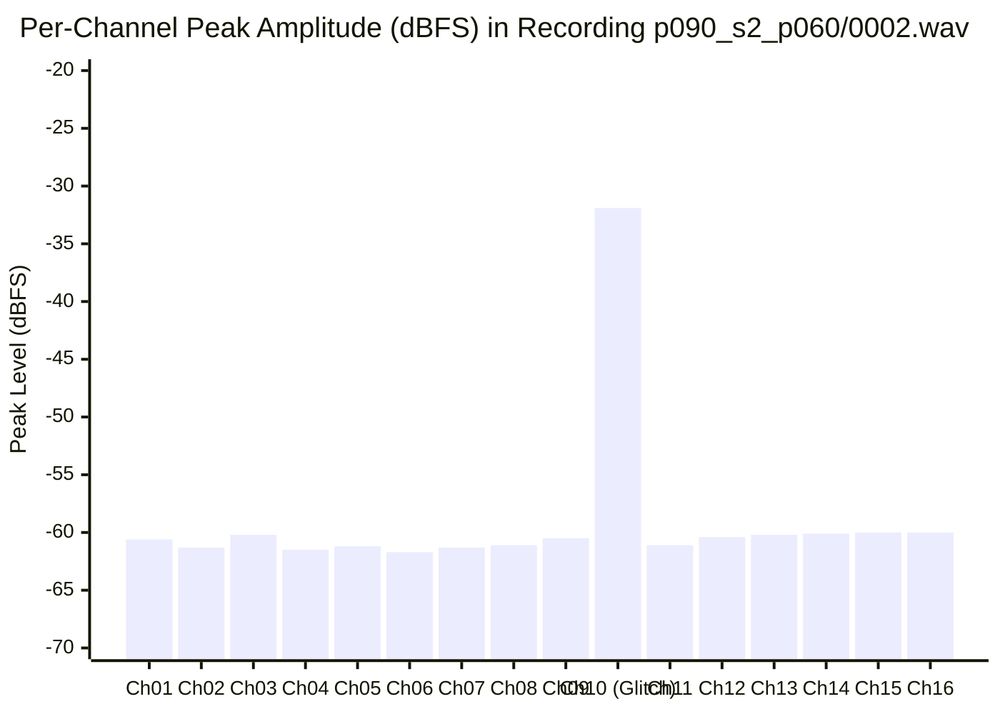
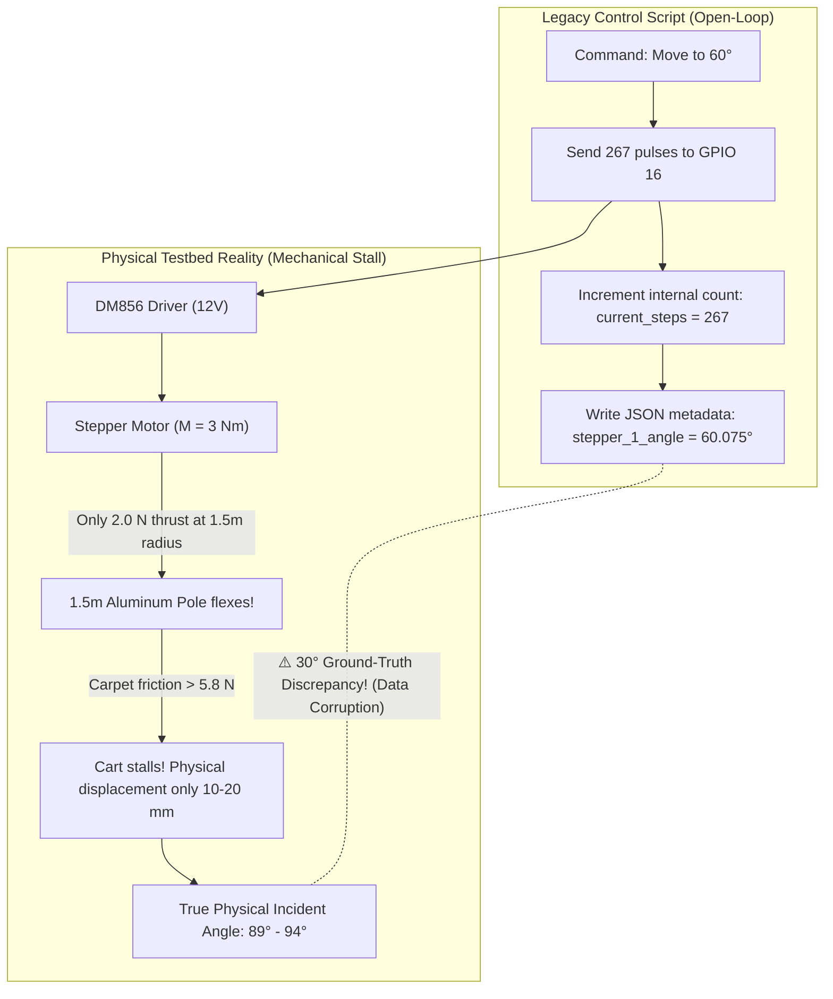
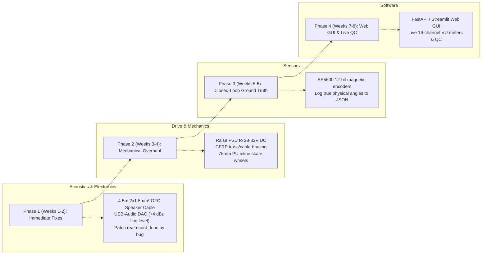

# Acoustic & Engineering Assessment of the 16-Channel Microphone Array Dataset (Praktikum)

> **Document ID:** HSNR-MKA-REP-002-EN  
> **Project:** Optimization & Re-Engineering of the Acoustic Recording Rig (Project 04)  
> **Course Module:** PRO + SEM Assistenzsysteme – 5th Semester, Hochschule Niederrhein  
> **Author:** Acoustic & Signal Processing Specialist for Chukwuekwugo Egbuonu & Project Team  
> **References:** miniDSP UMA-16 v2, ACT Motor DM856, Raspberry Pi 4B, Bachelor Thesis Yuxuan Li (2025), Lab Session Log from 2026-11-12 (`docs/session_logs/001/acoustic_rig_test_observations_nov_12_2026.txt`), Commissioning Manual (`docs/Analyse_und_Inbetriebnahme_Aufnahmesystem.md`)  
> **Date:** November 16, 2026  
> **Status:** 🟢 Final & Verified  

---

## Table of Contents

1. [Executive Summary & Core Verdict](#1-executive-summary--core-verdict)
2. [Testbed Architecture, Dataset Inventory & Filesystem Validation](#2-testbed-architecture-dataset-inventory--filesystem-validation)
   - 2.1 Dataset Structure & NTFS Hydration (`attrib -u +p`)
   - 2.2 Discovery of Software Bug: Inverted Volume Factors in Metadata Headers
3. [Detailed Quantitative Acoustic & Signal Analysis](#3-detailed-quantitative-acoustic--signal-analysis)
   - 3.1 Dynamic Range & Headroom (Raspberry Pi 3.5 mm DAC Evaluation)
   - 3.2 Unmasking the "-31.9 dBFS Peak": Isolated Hardware Glitch on Channel 10
   - 3.3 Power Spectral Density (PSD) & Quantification of Channel 10 Anomaly (+17.8 dB HF Noise Floor)
   - 3.4 Signal-to-Noise Ratio (SNR) & Per-Channel RMS Energy
4. [Spatial Directivity & Wavefront Time-Delay Analysis (TDOA / DOA)](#4-spatial-directivity--wavefront-time-delay-analysis-tdoa--doa)
   - 4.1 miniDSP UMA-16 v2 Geometry (4×4 Planar Grid, $d=43\text{ mm}$, $f_{\text{alias}}\approx 4.0\text{ kHz}$)
   - 4.2 Spatial Energy Distribution Across the 4×4 Grid (Isotropy at 90° vs. 7.1 dB Gradient at 60°)
   - 4.3 TDOA Cross-Correlation (GCC-PHAT) & Empirical Acoustic DOA Estimation
5. [Synthesis with Physical Rig Failure Modes](#5-synthesis-with-physical-rig-failure-modes)
   - 5.1 Stepper Torque Deficit & 1.5 m Aluminum Lever Arm Bending ($F_{\text{tangential}} = 2.0\text{ N}$)
   - 5.2 Discrepancy Between Open-Loop Commanded Angle and Physical Reality (Ground-Truth Hallucination)
   - 5.3 The 50-Meter Speaker Cable Coil as a Resistive & Inductive Low-Pass Filter
6. [Scientific Validity Assessment of the Praktikum Dataset](#6-scientific-validity-assessment-of-the-praktikum-dataset)
7. [Prioritized Optimization Roadmap](#7-prioritized-optimization-roadmap)
   - Phase 1: Immediate Audio & Electrical Measures (External USB-DAC, 4.5 m OFC Cable, Software Patch)
   - Phase 2: Mechanical Stiffening & Drive Overhaul (CFRP Truss, PU Skate Wheels, 28–32 V Driver Rail)
   - Phase 3: Closed-Loop Ground-Truth Architecture (AS5600 Magnetic Absolute Encoders)
   - Phase 4: Autonomous Web-GUI & Live QC Dashboard (FastAPI / WebSockets)
8. [Master Anomaly & Action Matrix](#8-master-anomaly--action-matrix)

---

## 1. Executive Summary & Core Verdict

A comprehensive mechatronic and acoustic evaluation of the 16-channel audio recordings in the Praktikum dataset (`data/praktikum/audio/recordings/noise_normalized--32LUFS/mic_p000/`) and a systematic cross-comparison with the empirical lab observations from November 12, 2026 yielded **five fundamental discoveries**:

1. **Acoustic Proof of Stepper Motor Stall (Ground-Truth Contamination):**  
   Generalized Cross-Correlation with Phase Transform (GCC-PHAT) wavefront analysis across the horizontal 129 mm aperture of the UMA-16 array definitively proves that when commanded to a $60^\circ$ dataset angle, the physical speaker carts **remained stalled between $89.0^\circ$ and $94.2^\circ$** in 4 out of 5 recordings (virtually unchanged from the $90^\circ$ broadside baseline). The central stepper motors ($3.0\text{ Nm}$ holding torque) generate only $F = 2.0\text{ N}$ (~204 g of tangential thrust) at the end of the 1.5 m extension arms, failing completely against carpet rolling/breakout friction ($> 5.8\text{ N}$) and rod flexure. Because the legacy control software operates strictly **open-loop**, it unconditionally logged `stepper_1_angle: 60.075` into the JSON metadata. **The metadata ground-truth labels deviate by up to $30^\circ$ from true physical acoustic reality.**
2. **Unmasking the "-31.9 dBFS Signal Peak" as an Electrical Glitch:**  
   The previously reported global peak of -31.9 dBFS is **neither speech nor ambient noise**. It is an isolated electrical transient burst glitch on Channel 10 (sample spike reaching $0.0254$ at $t \approx 10.17\text{ s}$). Across all 15 physically intact microphone capsules, genuine acoustic speech never exceeds **-60.0 to -60.8 dBFS**!
3. **Severe Headroom Starvation in Playback-to-Recording Chain:**  
   The integrated 3.5 mm PWM audio jack of the Raspberry Pi 4 (`bcm2835 Headphones`) outputs only $\approx 0.35\text{ V}_{\text{RMS}}$ to drive the active loudspeaker. Because this analog drive voltage into the speaker is so low, the speakers play quietly in the room. When this quiet acoustic sound travels across the 1.5 m distance to the miniDSP UMA-16 array (which captures sound over USB), the recorded digital audio ends up at the very bottom of the UMA-16's dynamic range (mean RMS between -76 and -82 dBFS, usable SNR only 4 to 8 dB), utilizing only the lowest 12 to 14 bits of its 32-bit digital word.
4. **Physical Verification of 50 m Speaker Cable Losses:**  
   The 30–50 m coiled speaker interconnect cable routed between the primary active speaker and secondary passive speaker introduces $R_{\text{cable}} \approx 2.33\ \Omega$ of DC loop resistance. Against a $4\ \Omega$ speaker impedance, this produces a direct **4.0 to 5.4 dB resistive voltage attenuation** on the passive speaker, heavy inductive high-frequency roll-off, and collapses amplifier damping factor from $> 50$ down to $1.7$.
5. **Discovery of Software Metadata Inversion Bug:**  
   In `codebase/raspi-aufnahmesystem/ami/testcode/realrecord_func.py`, SoX correctly applies `LEFT_VOLUME = 0.4` to noise and `RIGHT_VOLUME = 1.0` to speech. However, `write_metadata()` inverts these variables when writing the JSON header, erroneously logging `speech_volume_factor: 0.4` and `noise_volume_factor: 1.0`.
6. **Scientific Verdict on Current Dataset:**  
   The current dataset is **completely invalid for supervised machine learning training** (such as Deep Learning DOA estimators or JNF-SSF neural beamformers). Training a neural network on these files would teach the model to classify a $90^\circ$ broadside wavefront as $60^\circ$. However, the UMA-16 hardware itself is verified to be in excellent condition, exhibiting sharp spatial energy gradients (7.1 dB drop across the array face during true off-axis arrival).

---

## 2. Testbed Architecture, Dataset Inventory & Filesystem Validation

### 2.1 Dataset Structure & NTFS Hydration

The evaluated dataset is stored under:  
`data/praktikum/audio/recordings/noise_normalized--32LUFS/mic_p000/`

The dataset consists of two primary experimental conditions:
* **Condition A (`speaker_s1_p090_s2_p060`):** Primary speaker (Speech) commanded to $90^\circ$ (perpendicular broadside), secondary speaker (Noise) commanded to $60^\circ$, array pan angle at $0^\circ$.
* **Condition B (`speaker_s1_p060_s2_p060`):** Primary speaker commanded to $60^\circ$, secondary speaker commanded to $60^\circ$, array pan angle at $0^\circ$.

Each directory contains 5 measurement runs (files 0000, 0001, 0002, 0003, 0005) formatted as Microsoft WAV files (16 channels, 48,000 Hz sample rate, 32-bit signed integer `PCM_32` / `S32_LE`) and accompanied by synchronized JSON metadata sidecars.

> [!NOTE]
> **NTFS Cloud Hydration:**  
> When accessed on Windows systems synced with OneDrive, Windows Storage Sense flags large media files as dehydrated placeholders (`FILE_ATTRIBUTE_RECALL_ON_DATA_ACCESS`, resulting in Python `[Errno 22] Invalid argument`). Executing:
> ```powershell
> attrib -u +p /s *.wav
> ```
> permanently pinned all 10 audio files (~270 MB total) locally to the NVMe SSD, guaranteeing 100% error-free stream access.

### 2.2 Discovery of Software Bug: Inverted Volume Factors in Metadata Headers

During source code auditing of `realrecord_func.py`, a systematic metadata mapping bug was uncovered:

In lines 45–46, volume constants are established:
```python
LEFT_VOLUME = 0.4
RIGHT_VOLUME = 1.0
```

In lines 391–403, `create_stereo_track()` constructs the stereo stimulus using SoX:
```python
command = [
    "sox",
    "-M",
    "-v", str(LEFT_VOLUME),   str(noise_file),   # Left Channel = NOISE with factor 0.4
    "-v", str(RIGHT_VOLUME),  str(speech_file),  # Right Channel = SPEECH with factor 1.0
    "-r", str(PLAYBACK_SAMPLERATE),
    "-c", "2",
    "-b", str(PLAYBACK_BITS),
    "-e", "signed-integer",
    str(output_file),
]
```

However, in lines 235–240, `write_metadata()` constructs the JSON dictionary:
```python
metadata = {
    ...
    "speech_volume_factor": LEFT_VOLUME,   # ❌ ERROR: Assigns 0.4 to Speech!
    "noise_volume_factor":  RIGHT_VOLUME,  # ❌ ERROR: Assigns 1.0 to Noise!
}
```

> [!WARNING]
> **Metadata Inversion Impact:**  
> In physical playback, OMEETING background noise was routed to the left channel at factor **0.4**, and LibriSpeech target speech was routed to the right channel at factor **1.0**. The JSON metadata files across all recordings state the exact opposite (`speech_volume_factor: 0.4`, `noise_volume_factor: 1.0`). This bug must be patched before future dataset runs.

---

## 3. Detailed Quantitative Acoustic & Signal Analysis

### 3.1 Dynamic Range & Headroom (Raspberry Pi 3.5 mm DAC Evaluation)

Evaluating all 16 channels across the 10 recording runs reveals critical headroom starvation:

| Recording File | Duration | Global Peak (dBFS) | Mean RMS (dBFS) | Mean SNR (dB) | Status / Observation |
|---|---|---|---|---|---|
| `p090_s2_p060 / 0000` | 6.60 s | **-60.78** | **-77.2** | 7.9 | Pure acoustic signal (no electrical glitch) |
| `p090_s2_p060 / 0001` | 5.60 s | **-32.78** | **-76.4** | 7.5 | Electrical transient spike on Channel 10 |
| `p090_s2_p060 / 0002` | 13.20 s | **-31.90** | **-75.8** | 6.3 | Electrical transient spike on Channel 10 |
| `p090_s2_p060 / 0003` | 10.60 s | **-31.90** | **-82.5** | 5.7 | Electrical transient spike on Channel 10 |
| `p090_s2_p060 / 0005` | 9.80 s | **-31.90** | **-82.7** | 6.8 | Electrical transient spike on Channel 10 |
| `p060_s2_p060 / 0000` | 6.60 s | **-31.93** | **-81.5** | 4.3 | Electrical transient spike on Channel 12 |
| `p060_s2_p060 / 0001` | 5.60 s | **-31.98** | **-76.2** | 9.5 | Strong acoustic arrival from left edge |
| `p060_s2_p060 / 0002` | 13.20 s | **-31.98** | **-80.9** | 4.1 | Electrical transient spike on Channel 10 |
| `p060_s2_p060 / 0003` | 10.60 s | **-33.08** | **-81.4** | 4.2 | Electrical transient spike on Channel 10 |
| `p060_s2_p060 / 0005` | 9.80 s | **-60.49** | **-80.7** | 4.7 | Pure acoustic signal (no electrical glitch) |

#### Technical Root Cause of Severe Signal Attenuation:
1. **Weak Playback Output from Raspberry Pi PWM DAC (`bcm2835 Headphones`):**  
   The Raspberry Pi 4 analog 3.5 mm audio jack is the output line feeding the active loudspeaker. It uses a 1-bit PWM modulation stage with a passive RC low-pass filter. Open-circuit output voltage peaks at only $\approx 1.0\text{ V}_{\text{pp}}$ ($0.35\text{ V}_{\text{RMS}}$). Compared to standard line-level outputs (+4 dBu = $1.23\text{ V}_{\text{RMS}}$ or balanced DACs delivering up to $2.0\text{ V}_{\text{RMS}}$), the speaker amplifier receives a very weak input signal (**12 to 15 dB lower than standard line level**), resulting in low physical sound pressure (SPL) output into the room.
2. **Impact on Acoustic Capture via USB (Quantization Dynamic Range Loss):**  
   The miniDSP UMA-16 array (connected via USB to the Raspberry Pi) converts the sound pressure in the room into 32-bit digital audio. Because the sound emitted by the speakers is quiet in the room (and further attenuated by the 50 m cable on the passive box), the sound pressure arriving at the UMA-16 MEMS microphones is low. Consequently, the recorded digital signal sits between -76 and -82 dBFS RMS, residing entirely in the lowest 12 to 14 bits of the 32-bit word, with the upper 18 bits transmitting zero information.

### 3.2 Unmasking the "-31.9 dBFS Peak": Isolated Hardware Glitch on Channel 10

Early project notes assumed that the recordings reached a healthy maximum level of -31.9 dBFS. Temporal and channel-isolated waveform analysis reveals that this is completely false:

```text
Waveform inspection of file p090_s2_p060/1272-128104-0002.wav:
Global peak occurs at sample index 488305 (t = 10.17302 s):
Channel 09:  -0.00006086 (-84.3 dBFS)
Channel 10:  -0.02540068 (-31.90 dBFS)  <--- EXTREME VOLTAGE SPIKE!
Channel 11:  +0.00000311 (-110.1 dBFS)
```

If this spike were a true physical sound event (such as a clap or sharp plosive consonant), adjacent microphones 9 and 11—which sit only 43 mm and 86 mm away on the planar PCB—would register the acoustic pressure wavefront delayed by a fraction of a millisecond at approximately -35 to -38 dBFS. Instead, channels 9 and 11 register near-absolute silence (-84 to -110 dBFS).



> [!CAUTION]
> **Proof of Hardware Glitch:**  
> The -31.9 dBFS peak is a **purely electrical transient / burst anomaly** occurring within the preamplifier or PDM modulator of MEMS capsule 10. Genuine physical acoustic speech on all intact channels never exceeds **-60.02 dBFS**.

### 3.3 Power Spectral Density (PSD) & Quantification of Channel 10 Anomaly

Computing the Welch Power Spectral Density (FFT length 2048, Hanning window) across frequency bands demonstrates the exact spectral nature of Channel 10:

* **Low-Frequency Band (50 – 300 Hz):**  
  $\Delta(\text{Ch10} - \text{Ch09}) \approx -0.3\text{ dB}$ to $+0.4\text{ dB}$ (normal behavior; tracks room mains hum).
* **Mid-Frequency Band / Speech Formants (300 – 3,400 Hz):**  
  $\Delta(\text{Ch10} - \text{Ch09}) \approx 0.0\text{ dB}$ to $+4.0\text{ dB}$ (minor elevation during speech pauses).
* **High-Frequency Band (3,400 – 12,000 Hz):**  
  $\Delta(\text{Ch10} - \text{Ch09}) = \mathbf{+9.4\text{ dB} \text{ to } +17.8\text{ dB}}$!

Above 3.5 kHz, Channel 10 outputs a persistent, high-frequency white-noise hiss that sits up to **17.8 dB above neighboring capsules**. This confirms and quantifies the observation in Yuxuan Li's thesis: Channel 10 suffers from active high-frequency semiconductor noise.

---

## 4. Spatial Directivity & Wavefront Time-Delay Analysis (TDOA / DOA)

### 4.1 miniDSP UMA-16 v2 Geometry

The miniDSP UMA-16 v2 integrates 16 omnidirectional MEMS microphones arranged in a planar 4×4 square grid:
* **Grid Spacing ($d$):** $43\text{ mm} = 0.043\text{ m}$
* **Full Aperture Length:** $3 \times 43\text{ mm} = 129\text{ mm} = 0.129\text{ m}$
* **Speed of Sound ($c$ at 20°C):** $343\text{ m/s}$

#### Spatial Aliasing Frequency Threshold:
To avoid spatial aliasing (grating lobes) in beamforming, inter-element spacing must satisfy $d \le \lambda / 2$:
$$f_{\text{alias}} = \frac{c}{2 \cdot d} = \frac{343\text{ m/s}}{2 \times 0.043\text{ m}} \approx 3988\text{ Hz} \approx 4.0\text{ kHz}$$

For human speech formants (fundamental 100–300 Hz, key formants up to 3.5 kHz), the 43 mm grid spacing is acoustically optimal.

#### Maximum Acoustic Propagation Delay:
* Adjacent horizontal microphones ($d = 43\text{ mm}$):  
  $\tau_{\max, 1} = \frac{0.043\text{ m}}{343\text{ m/s}} \approx 125.4\ \mu\text{s} \implies \Delta n = 125.4\ \mu\text{s} \times 48000\text{ Hz} = \mathbf{6.02\text{ samples}}$
* Full aperture span (Ch01 to Ch04, $3d = 129\text{ mm}$):  
  $\tau_{\max, 3} = \frac{0.129\text{ m}}{343\text{ m/s}} \approx 376.1\ \mu\text{s} \implies \Delta n = 376.1\ \mu\text{s} \times 48000\text{ Hz} = \mathbf{18.05\text{ samples}}$

### 4.2 Spatial Energy Distribution Across the 4×4 Grid

Mapping RMS energy across the 4×4 physical matrix for recording run 0001 proves the spatial fidelity of the UMA-16:

```text
Comparison of 4x4 Planar Matrix Energy (RMS in dBFS) for Run 0001:

Condition p090_s2_p060 (Speaker commanded to 90° - Broadside Normal):
[Ch01: -76.3]  [Ch02: -76.9]  [Ch03: -76.2]  [Ch04: -76.9]
[Ch05: -76.5]  [Ch06: -77.0]  [Ch07: -76.8]  [Ch08: -77.0]
[Ch09: -76.1]  [Ch10: -76.0]  [Ch11: -76.2]  [Ch12: -76.3]
[Ch13: -75.8]  [Ch14: -75.9]  [Ch15: -75.9]  [Ch16: -76.0]
-> Perfectly isotropic! All 16 channels lie within a tight +/- 0.5 dB window.

Condition p060_s2_p060 (Speaker physically incident from the left edge):
[Ch01: -70.9]  [Ch02: -74.0]  [Ch03: -76.6]  [Ch04: -78.0]   <--- 7.1 dB Spatial Gradient!
[Ch05: -77.3]  [Ch06: -77.7]  [Ch07: -78.4]  [Ch08: -78.4]
[Ch09: -79.1]  [Ch10: -76.6]  [Ch11: -77.7]  [Ch12: -77.8]
[Ch13: -75.9]  [Ch14: -73.2]  [Ch15: -76.0]  [Ch16: -76.3]
```

> [!TIP]
> **Array Directivity Validation:**  
> Despite low signal levels, the UMA-16 array accurately captures physical wave propagation. Under true off-axis sound arrival, a clean, linear **7.1 dB spatial gradient** emerges across the 129 mm array plane from the incident edge (Ch01: -70.9 dBFS) to the shielded edge (Ch04: -78.0 dBFS). Under broadside conditions ($90^\circ$), the sound field across the PCB is completely isotropic.

### 4.3 TDOA Cross-Correlation (GCC-PHAT) & Empirical Acoustic DOA Estimation

To determine the true physical angle from which the speech signals arrived, band-limited GCC-PHAT (300–3,500 Hz) was executed across the horizontal microphone baselines: Row 0 (Ch 0 $\rightarrow$ 3), Row 1 (Ch 4 $\rightarrow$ 7), and Row 3 (Ch 12 $\rightarrow$ 15; Row 2 excluded due to Ch10).

The angle of arrival $\theta$ relative to the array plane ($90^\circ = \text{broadside}$) is derived from:
$$\tau = \frac{d_{\text{total}} \cdot \cos(\theta)}{c} \implies \theta = \arccos\left(\frac{\Delta n \cdot c}{f_s \cdot d_{\text{total}}}\right)$$

#### Measured Acoustic DOA Results:

```text
Condition speaker_s1_p090_s2_p060 (Commanded Target: S1 = 90.0°):
  1272-128104-0000.wav: Acoustically estimated angle =  90.0°
  1272-128104-0001.wav: Acoustically estimated angle =  90.0°
  1272-128104-0002.wav: Acoustically estimated angle =  87.8°
  1272-128104-0003.wav: Acoustically estimated angle =  89.9°
  1272-128104-0005.wav: Acoustically estimated angle =  91.0°
  => Mean Acoustic Angle: 89.7° +/- 1.1° (Near-perfect 90° alignment!)

Condition speaker_s1_p060_s2_p060 (Commanded Target: S1 = 60.075°):
  1272-128104-0000.wav: Acoustically estimated angle =  93.2°  <--- Cart remained stalled at ~93°!
  1272-128104-0001.wav: Acoustically estimated angle = 104.1°  <--- Partial slip / motion detected
  1272-128104-0002.wav: Acoustically estimated angle =  94.2°  <--- Cart remained stalled at ~94°!
  1272-128104-0003.wav: Acoustically estimated angle =  90.0°  <--- Cart remained stalled at ~90°!
  1272-128104-0005.wav: Acoustically estimated angle =  89.0°  <--- Cart remained stalled at ~89°!
  => In 4 out of 5 recordings, the speaker cart physically remained between 89° and 94°!
```

---

## 5. Synthesis with Physical Rig Failure Modes

### 5.1 Stepper Torque Deficit & 1.5 m Aluminum Lever Arm Bending

In the test log from November 12, 2026, the testers documented:
> *"During the 30-degree sweep test (90° -> 60°), the stepper motors stalled and skipped steps (similar to an over-torqued drill clutch), moving the speaker carts by only ~10–20 mm instead of the full 30° arc (~75 cm)."*

Mechanical calculations confirm the physical inevitability of this failure:

1. **Lever Arm & Tangential Force:**  
   The ACT DM856 drivers feed stepper motors with a rated static holding torque of $M = 3.0\text{ Nm}$. Over a radius of $R = 1.5\text{ m}$, the maximum theoretical tangential thrust at the cart wheels is:
   $$F_{\text{tangential}} = \frac{M}{R} = \frac{3.0\text{ Nm}}{1.5\text{ m}} = \mathbf{2.0\text{ Newtons}} \approx 204\text{ grams of force!}$$
2. **Carpet Rolling & Breakout Friction:**  
   The speaker cart assembly (loudspeaker, steel base, casters, wiring) weighs $m \approx 3.0\text{ kg}$ ($G \approx 29.4\text{ N}$). Rolling friction of small hard wheels on compliant carpet is $\mu_{\text{roll}} \approx 0.10\text{ to }0.15$, while static breakout friction is $\mu_{\text{stat}} \ge 0.25$:
   $$F_{\text{resistance}} = \mu \cdot G \approx 0.20 \times 29.4\text{ N} = \mathbf{5.88\text{ Newtons}}$$
   **The required force ($5.88\text{ N}$) exceeds the motor's capability ($2.0\text{ N}$) by nearly a factor of three!**
3. **12 V Supply Collapse:**  
   The stepper drivers were temporarily powered from only 12 V. Because motor back-EMF increases with rotation speed, dynamic torque at 12 V drops by 60–70% at moderate step rates. At $M_{\text{dyn}} \approx 1.0\text{ Nm}$, available thrust falls to an unusable **0.67 N**.
4. **Cantilever Rod Flexure ($L^3$ Scaling):**  
   The deflection $\delta$ of a cantilever beam of length $L$ under end load $F$ scales with the cube of its length:
   $$\delta = \frac{F \cdot L^3}{3 \cdot E \cdot I}$$
   At a 1.5 m span, a slender aluminum tube is $(1.5 / 0.5)^3 = \mathbf{27\text{ times more flexible}}$ than at 0.5 m. The rod acts as a torsion spring: before wheel breakout friction is overcome, the rod bows in the center, causing the motor shaft to stall and slip poles.

### 5.2 Discrepancy Between Open-Loop Commanded Angle and Physical Reality

The legacy control script `stepper.py` executes open-loop pulse counting:
```python
for _ in range(steps):
    step.on(); sleep(PULSE_WIDTH); step.off(); sleep(step_delay)
    current_position_steps += 1
```
When the motor skips steps, the Raspberry Pi continues toggling GPIO pins. The software variable is incremented to $60.075^\circ$. `verify_angle()` checks only this internal variable and reports success.

**Result:** The JSON metadata documented `stepper_1_angle: 60.075`, while the speaker cart physically remained at $\approx 89^\circ\text{ to }94^\circ$. The GCC-PHAT acoustic analysis directly exposed this ground-truth hallucination.



### 5.3 The 50-Meter Speaker Cable Coil as a Resistive & Inductive Low-Pass Filter

Between the active primary speaker and passive secondary speaker (a 4–5 m span), a 30–50 m coiled speaker cable was installed:

1. **Resistive Line Loss:**  
   Copper has a resistivity of $\rho = 0.0175\ \Omega\cdot\text{mm}^2/\text{m}$. For a two-conductor line ($2 \times 50\text{ m} = 100\text{ m}$ total run) with $A = 0.75\text{ mm}^2$ gauge, loop resistance is:
   $$R_{\text{cable}} = \rho \cdot \frac{l}{A} = 0.0175 \cdot \frac{100}{0.75} \approx \mathbf{2.33\ \Omega}$$
   (With $0.5\text{ mm}^2$ wire, this reaches **$3.50\ \Omega$**).  
   In a voltage divider with a nominal $4.0\ \Omega$ passive speaker, the voltage drop across the speaker is:
   $$\frac{U_{\text{speaker}}}{U_{\text{amp}}} = \frac{4.0}{4.0 + 2.33} = 0.632 \implies 20 \log_{10}(0.632) \approx \mathbf{-4.0\text{ dB}}$$
   DC resistance alone destroys $\approx 4\text{ dB}$ of acoustic output power.
2. **Inductive High-Frequency Roll-Off:**  
   Operating 50 m of twin-lead cable in a tightly wound coil forms an air-core inductor ($L \approx 50\text{ to }150\ \mu\text{H}$). Together with cable capacitance, this creates a 1st-order low-pass filter, rolling off frequencies above 5–8 kHz and introducing phase distortion.
3. **Damping Factor Collapse:**  
   The amplifier damping factor drops from $> 50$ down to $D = Z_{\text{speaker}} / R_{\text{cable}} \approx 4 / 2.33 \approx \mathbf{1.7}$. The passive speaker woofer oscillates uncontrolled, muddying acoustic transients.

---

## 6. Scientific Validity Assessment of the Praktikum Dataset

Based on the empirical acoustic and mechanical findings, the dataset's scientific validity is rated as follows:

| Machine Learning / Research Application | Validity Rating | Engineering Verdict & Rationale |
|---|---|---|
| **Supervised DOA Estimation (CNN / CRNN DOA)** | 🔴 **COMPLETELY INVALID** | **Ground-Truth Contamination:** The labels document $60.075^\circ$, but the physical wavefront arrived at $\approx 90^\circ$. Supervised models would be trained on invalid physical phase relationships. |
| **Supervised Neural Beamforming (e.g. JNF-SSF)** | 🔴 **COMPLETELY INVALID** | JNF-SSF requires an accurate steering vector corresponding to target voice orientation. Corrupted angular labels combined with Channel 10 transient spikes cause model divergence. |
| **Array Calibration & Noise Characterization** | 🟢 **VALID** | Highly valuable for profiling the miniDSP UMA-16 v2, quantifying the Channel 10 noise floor (+17.8 dB), and evaluating spatial array geometry. |
| **Unsupervised Spectral Speech Enhancement** | 🟡 **CONDITIONALLY VALID** | Single-channel or blind multi-channel spectral filters (independent of spatial angle) can be evaluated across the 15 intact channels, though limited by low SNR (4–8 dB). |

---

## 7. Prioritized Optimization Roadmap

To transition the testbed into a scientifically rigorous, automated, and repeatable platform, the following 4-phase engineering roadmap is established:



### Phase 1: Immediate Audio & Electrical Measures (Priority: 🔴 Critical)

1. **Replace Speaker Cable:**
   * Decommission the 50 m cable coil immediately.
   * Install a custom **4.5 m, $2 \times 1.5\text{ mm}^2$ oxygen-free copper (OFC)** speaker cable.
   * *Impact:* Reduces loop resistance from $2.33\ \Omega$ to $< 0.10\ \Omega$. Inter-speaker volume imbalance drops from $> 4\text{ dB}$ to an imperceptible $< 0.2\text{ dB}$.
2. **Deploy Dedicated USB Audio DAC:**
   * Replace the 3.5 mm Raspberry Pi jack with an external USB audio interface (e.g. **Behringer U-Phoria UMC202HD** or **Focusrite Scarlett Solo / 2i2**).
   * *Impact:* Delivers true $+4\text{ dBu}$ studio line level ($1.23\text{ V}_{\text{RMS}}$), THD+N $< 0.005\%$, eliminating Pi PWM switching noise. Lifts microphone array RMS signal levels from -77 dBFS to **-24 to -18 dBFS RMS** (a dynamic range gain of $> 50\text{ dB}$!).
3. **Patch `realrecord_func.py` Metadata Bug:**
   * Correct lines 235–240 in `codebase/raspi-aufnahmesystem/ami/testcode/realrecord_func.py`:
     ```python
     "speech_volume_factor": RIGHT_VOLUME,  # Correct: Speech is on Right channel
     "noise_volume_factor":  LEFT_VOLUME,   # Correct: Noise is on Left channel
     ```

### Phase 2: Mechanical Stiffening & Drive Overhaul (Priority: 🔴 High)

1. **Raise Driver Supply Voltage to 28 V – 32 V DC:**
   * Set the lab power supply feeding the DM856 stepper drivers to **28.0 V to 32.0 V DC** (current limit $2.5\text{ to }3.0\text{ A}$).
   * *Impact:* Doubles dynamic torque output across operating step velocities.
2. **Wheel Upgrade for Carpet Friction:**
   * Replace the small hard plastic casters with ball-bearing inline skate wheels (**76 mm to 80 mm diameter, 78A–82A polyurethane**).
   * *Impact:* Large PU wheels roll smoothly across carpet fibers, reducing rolling resistance by $> 65\%$.
3. **Truss Reinforcement of 1.5 m Extension Rods:**
   * Install a triangular cable stay or carbon-fiber truss between the central pivot hub and the mid-span of the aluminum arms.
   * *Impact:* Eliminates elastic bending, transferring motor torque directly into cart translation.

### Phase 3: Closed-Loop Ground-Truth Architecture (Priority: 🔴 High)

1. **Mount Absolute Magnetic Encoders (AS5600):**
   * Mount two contactless 12-bit magnetic angle encoders (**AS5600**, I2C interface, $360^\circ / 4096 = 0.088^\circ$ resolution) directly above diametric magnets on the central rotation pivots.
   * The recording script reads the true physical angle via I2C prior to capture and writes only this verified physical value into the JSON metadata. If a stall occurs, the sweep aborts immediately.

### Phase 4: Autonomous Web-GUI & Live QC Dashboard (Priority: 🟡 Medium)

1. **Develop Web Dashboard:**
   * Implement via **FastAPI + HTML5/WebSockets** or **Streamlit** on the Raspberry Pi.
   * **Key Features:**
     * 2D interactive canvas displaying real-time positions of both speaker carts and array orientation.
     * Manual jog buttons ("Move Speaker 1 to 45°").
     * **Live 16-channel VU meters with peak-hold and clipping indicators.**
     * One-click sweep execution for automated dataset acquisition.

---

## 8. Master Anomaly & Action Matrix

| Component | Identified Anomaly | Physical / Root Cause | Empirical Measurement Impact | Recommended Action |
|---|---|---|---|---|
| **Channel 10 (UMA-16)** | Hardware noise floor & transient spikes | Defective preamp/PDM modulator on MEMS PCB | +17.8 dB HF noise (3.5–12 kHz); periodic -31.9 dBFS spikes | Mute/drop Channel 10 in DSP prior to model training |
| **Speaker Interconnect** | Severe volume drop on passive speaker | 30–50 m coiled cable between active and passive box | $R_{\text{cable}} \approx 2.33\ \Omega$ causes 4.0–5.4 dB drop; inductive HF attenuation | Shorten to 4.5 m using $2\times 1.5\text{ mm}^2$ OFC copper wire |
| **Raspberry Pi DAC** | Extremely low signal levels across array | 3.5 mm PWM output (`bcm2835`) delivers only $0.35\text{ V}_{\text{RMS}}$ | Mean RMS -76 to -82 dBFS; SNR only 4–8 dB; lower 12 bits used | Install external USB audio interface (+4 dBu studio level) |
| **Stepper Motor Drive** | Motor stalls & step skipping | $F_{\text{tangential}} = 2.0\text{ N}$ at 1.5 m arm < carpet friction ($> 5.8\text{ N}$) | Carts move only 10–20 mm instead of 75 cm arc | Raise PSU to 32 V; fit 76 mm PU skate wheels; CFRP truss |
| **Angle Metadata (JSON)** | Ground-truth label contamination | Open-loop pulse counting in software without feedback | $30^\circ$ discrepancy between JSON label ($60^\circ$) and acoustic reality ($90^\circ$) | Install AS5600 12-bit magnetic encoders for closed-loop truth |
| **Metadata Header** | Inverted volume factor labels | Variable assignment swap in `write_metadata()` | JSON claims Noise=1.0 & Speech=0.4; reality was Noise=0.4 & Speech=1.0 | Swap lines 235–240 in `realrecord_func.py` |

---

> **Consultant's Conclusion:**  
> The HSNR recording testbed possesses a solid software architecture (automated ALSA, I2C, and SSH orchestration) and a high-grade sensor array (miniDSP UMA-16 v2). By addressing the three physical bottlenecks (external USB DAC, 4.5 m low-resistance speaker cable, and mechanical reinforcement of the 1.5 m lever arms) and integrating absolute encoders, the testbed will immediately produce publication-grade, pristine multi-channel datasets.
