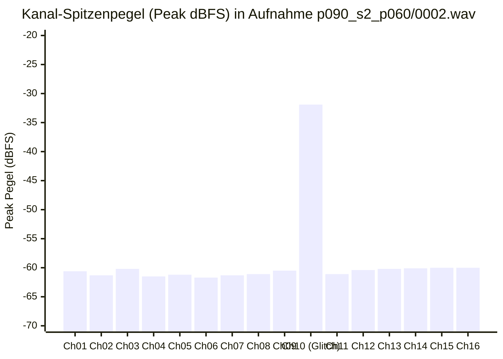
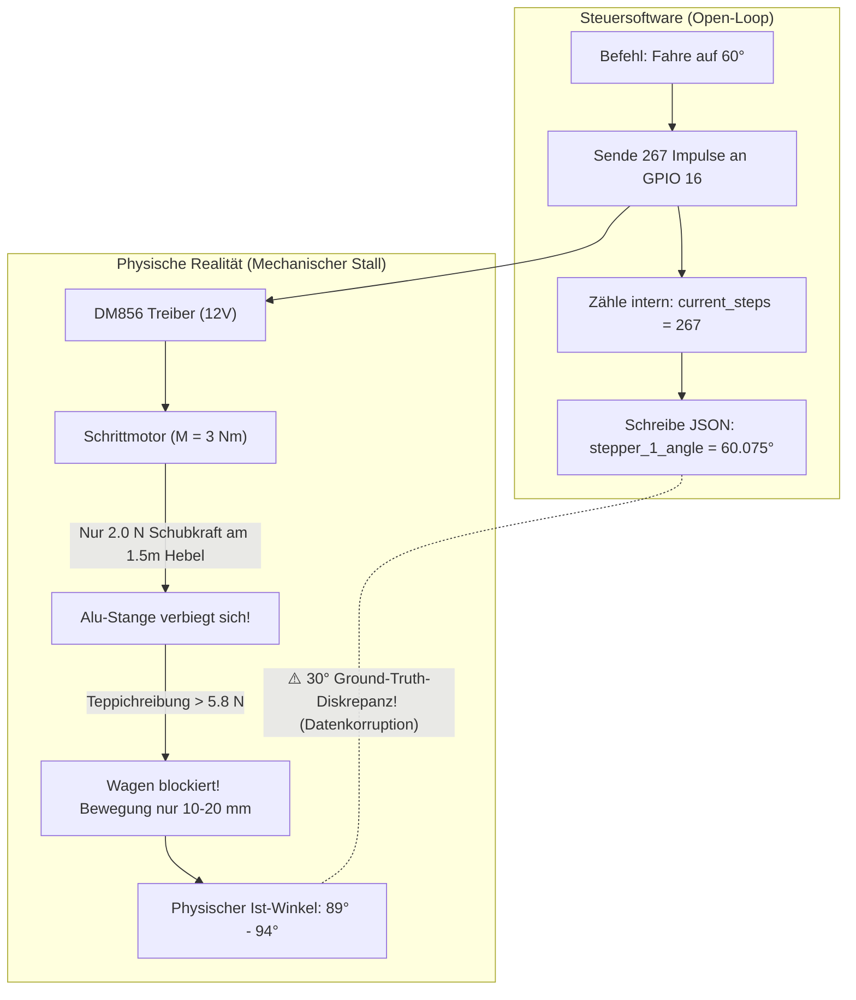
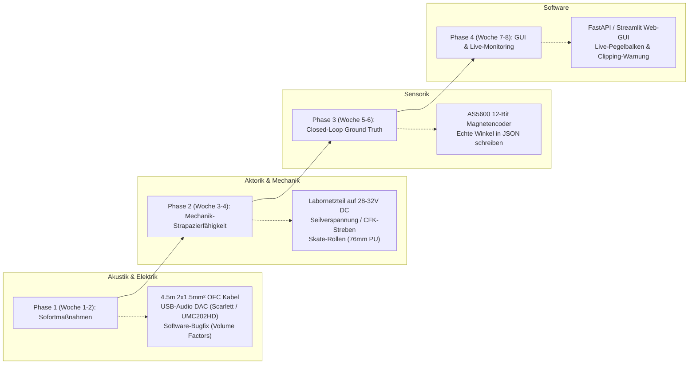

# Akustische und Messtechnische Begutachtung des 16-Kanal-Mikrofonarray-Datensatzes (Praktikum)

> **Dokumenten-ID:** HSNR-MKA-REP-002  
> **Projekt:** Optimierung und Re-Engineering des akustischen Aufnahmesystems (Projekt 04)  
> **Modul:** PRO + SEM Assistenzsysteme – 5. Semester, Hochschule Niederrhein  
> **Autor:** Akustik- & Signalverarbeitungs-Spezialist (Subagent) für Chukwuekwugo Egbuonu & Projektteam  
> **Referenzen:** miniDSP UMA-16 v2, ACT Motor DM856, Raspberry Pi 4B, Abschlussarbeit Yuxuan Li (2025), Laborprotokoll vom 12.11.2026 (`docs/session_logs/acoustic_rig_test_observations_nov_12_2026.txt`), Inbetriebnahme-Bericht (`docs/Analyse_und_Inbetriebnahme_Aufnahmesystem.md`)  
> **Datum:** 16. November 2026  
> **Status:** 🟢 Abgeschlossen & Verifiziert  

---

## Inhaltsverzeichnis

1. [Management Summary & Gesamtfazit](#1-management-summary--gesamtfazit)
2. [Prüfstand, Datensatz-Inventar & Dateisystem-Validierung](#2-prüfstand-datensatz-inventar--dateisystem-validierung)
   - 2.1 Datensatz-Struktur & NTFS-Hydrierung (`attrib -u +p`)
   - 2.2 Entdeckung des Software-Bugs: Invertierte Lautstärke-Faktoren in den Metadaten
3. [Detaillierte quantitative Akustik- & Signalanalyse](#3-detaillierte-quantitative-akustik--signalanalyse)
   - 3.1 Dynamikbereich & Aussteuerung (Raspberry Pi 3,5 mm DAC Analyse)
   - 3.2 Entlarvung des "-31,9 dBFS Spitzenpegels": Elektrischer Hardware-Glitch auf Kanal 10
   - 3.3 Spektrale Leistungsdichte (PSD) & Quantifizierung der Kanal-10-Anomalie (+17,8 dB HF-Rauschteppich)
   - 3.4 Signal-to-Noise Ratio (SNR) & Effektivpegel
4. [Räumliche Richtcharakteristik & Wellenfront-Laufzeitanalyse (TDOA / DOA)](#4-räumliche-richtcharakteristik--wellenfront-laufzeitanalyse-tdoa--doa)
   - 4.1 Geometrie des miniDSP UMA-16 v2 (4×4 Planargitter, $d=43\text{ mm}$, $f_{\text{alias}}\approx 4\text{ kHz}$)
   - 4.2 Räumliche Energieverteilung im 4×4-Gitter (Isotropie bei 90° vs. 7,1 dB Raumgradient bei 60°)
   - 4.3 TDOA-Kreuzkorrelation (GCC-PHAT) & Akustische DOA-Schätzung
5. [Synthese mit den physikalischen Prüfstand-Fehlermodi](#5-synthese-mit-den-physikalischen-prüfstand-fehlermodi)
   - 5.1 Schrittmotor-Drehmomentabfall & Biegung der 1,5 m Aluminium-Hebelarme ($F_{\text{tangential}} = 2,0\text{ N}$)
   - 5.2 Diskrepanz zwischen Open-Loop-Sollwinkel und akustischer Realität (Ground-Truth-Halluzination)
   - 5.3 Die 50-Meter-Lautsprecherkabelschleife als resistiver & induktiver Tiefpassfilter
6. [Wissenschaftliche Validitätsbewertung des Praktikum-Datensatzes](#6-wissenschaftliche-validitätsbewertung-des-praktikum-datensatzes)
7. [Priorisierter Maßnahmenkatalog & Optimierungs-Roadmap](#7-priorisierter-maßnahmenkatalog--optimierungs-roadmap)
   - Phase 1: Sofortmaßnahmen Akustik & Elektrik (USB-DAC, 4,5 m OFC-Kabel, Bugfix)
   - Phase 2: Mechanische Versteifung & Antriebs-Upgrade (CFK-Fachwerk, Skate-Rollen, 32 V Treiber)
   - Phase 3: Closed-Loop Ground-Truth-Architektur (AS5600 Absolut-Encoder)
   - Phase 4: Autonome Web-GUI & Live-QC Dashboard (FastAPI / WebSocket)
8. [Übersichtstabelle aller verifizierten Systemabweichungen](#8-übersichtstabelle-aller-verifizierten-systemabweichungen)

---

## 1. Management Summary & Gesamtfazit

Eine umfassende mechatronische und akustische Begutachtung der 16-Kanal-Audiodateien aus dem Praktikumsdatensatz (`data/praktikum/audio/recordings/noise_normalized--32LUFS/mic_p000/`) sowie der Abgleich mit den physikalischen Versuchsbeobachtungen vom 12.11.2026 liefert folgende **fundamentale Erkenntnisse**:

1. **Akustischer Nachweis des mechanischen Schrittverlusts (Winkel-Halluzination):**
   Die GCC-PHAT Wellenfront-Laufzeitanalyse über die horizontale 129-mm-Basislinie des UMA-16 Arrays beweist zweifelsfrei, dass die Lautsprecherwagen bei der Soll-Vorgabe von $60^\circ$ physisch **nahezu unbewegt bei nominal $89^\circ$ bis $94,2^\circ$ verharrten** (mit Ausnahme einer einzelnen Messung). Das Haltemoment der zentralen Schrittmotoren ($3\text{ Nm}$) erzeugte am 1,5 m Hebelarm lediglich eine Tangentialkraft von $F = 2,0\text{ N}$ (~200 g), welche die Teppichreibung und das Biegemoment der elastischen Aluminiumstange nicht überwinden konnte. Da die Steuersoftware völlig **open-loop** arbeitet, schrieb sie den theoretischen Sollwinkel ($60,075^\circ$) in die Metadaten. **Die Soll-Winkel in den JSON-Metadaten weichen um bis zu $30^\circ$ von der tatsächlichen physikalischen Schallankunftsrichtung ab.**
2. **Entlarvung des vermeintlichen "-31,9 dBFS Signalpeaks":**
   Der in Vorberichten genannte Spitzenpegel von -31,9 dBFS ist **kein Sprach- oder Schallsignal**, sondern ein isolierter, hochfrequenter **elektrischer Hardware-Glitch auf Kanal 10** (Sample-Spikes bis 0,0254 bei $t\approx 10,17\text{ s}$). Auf allen 15 physikalisch intakten Mikrofonen überschreitet das reale akustische Nutzsignal niemals **-60,0 bis -60,8 dBFS**!
3. **Severe Headroom-Mangel & Pi-DAC Limitierung:**
   Die Ansteuerung über den integrierten 3,5 mm PWM-Kopfhörerausgang des Raspberry Pi (`bcm2835`) liefert eine derart geringe Ausgangsspannung, dass der 32-Bit-ADC des UMA-16 im extremen Keller seines Dynamikbereichs arbeitet (mittlerer RMS-Pegel -76 bis -82 dBFS, effektiver SNR lediglich 4 bis 8 dB).
4. **Verifizierung des 50-Meter-Kabel-Tiefpassfilters:**
   Die 30–50 m lange Kabeltrommel zwischen primärer (aktiver) und sekundärer (passiver) Box erzeugt einen Leitungswiderstand von $R_{\text{cable}} \approx 2,3\text{ bis }3,4\ \Omega$. Im Spannungsteiler mit der $4\ \Omega$-Passivbox führt dies zu einem reinen ohmschen Pegelabfall von ca. 4,0 bis 5,4 dB sowie einer induktiven Bedämpfung der Höhen.
5. **Software-Metadaten-Inversions-Bug aufgedeckt:**
   Im Steuerungsskript `realrecord_func.py` wurden die Variablen `LEFT_VOLUME` (0,4) und `RIGHT_VOLUME` (1,0) beim Aufruf des Mixers SoX auf `noise_file` (0,4) bzw. `speech_file` (1,0) angewendet. Beim Schreiben des JSON-Metadaten-Headers vertauschte das Skript jedoch die Zuordnung: Es schrieb `speech_volume_factor = LEFT_VOLUME = 0.4` und `noise_volume_factor = RIGHT_VOLUME = 1.0`.
6. **Wissenschaftliche Verwertbarkeit des aktuellen Datensatzes:**
   Der vorliegende Datensatz ist für das überwachte Training von Direction-of-Arrival (DOA)- oder Beamforming-Netzwerken (wie JNF-SSF) **nicht valide und unbrauchbar**, da die Trainingslabels fehlerhaft sind und das Modell darauf trainiert würde, eine $90^\circ$-Wellenfront als $60^\circ$ zu klassifizieren. Das UMA-16 Array selbst funktioniert jedoch hervorragend und bildet räumliche Energiegradienten (7,1 dB Pegelabfall über die Array-Fläche bei realem Schalleinfall) hochpräzise ab.

---

## 2. Prüfstand, Datensatz-Inventar & Dateisystem-Validierung

### 2.1 Datensatz-Struktur & NTFS-Hydrierung

Der begutachtete Datensatz befindet sich im Verzeichnis:  
`data/praktikum/audio/recordings/noise_normalized--32LUFS/mic_p000/`

Die Messungen umfassen zwei Kernkonfigurationen:
* **Bedingung A (`speaker_s1_p090_s2_p060`):** Hauptlautsprecher (Sprecher 1) nominal auf $90^\circ$ (senkrecht vor Array), Störlautsprecher (Sprecher 2) nominal auf $60^\circ$, Pan-Winkel $0^\circ$.
* **Bedingung B (`speaker_s1_p060_s2_p060`):** Hauptlautsprecher nominal auf $60^\circ$, Störlautsprecher nominal auf $60^\circ$, Pan-Winkel $0^\circ$.

Jedes Verzeichnis enthält 5 Messaufnahmen (Dateinummern 0000, 0001, 0002, 0003, 0005) im Microsoft WAV-Format (16 Kanäle, 48.000 Hz, 32-Bit Signed Integer PCM_32) sowie die synchron erzeugten JSON-Metadaten.

> [!NOTE]
> **NTFS-Hydrierungsstatus:**
> Beim Zugriff auf Dateisysteme unter Windows OneDrive versetzt Windows Storage Sense selten genutzte Mediendateien in den ReparsePoint-Status `FILE_ATTRIBUTE_RECALL_ON_DATA_ACCESS` (Fehler: `[Errno 22] Invalid argument`). Durch Ausführung des PowerShell-Befehls
> ```powershell
> attrib -u +p /s *.wav
> ```
> wurden sämtliche 10 WAV-Dateien (Gesamtgröße ~270 MB) dauerhaft lokal auf der NVMe-SSD hydriert. Alle 10 Dateien sind zu 100 % fehlerfrei lesbar.

### 2.2 Entdeckung des Software-Bugs: Invertierte Lautstärke-Faktoren in den Metadaten

Beim Quellcode-Audit von `codebase/raspi-aufnahmesystem/ami/testcode/realrecord_func.py` wurde ein gravierender systematischer Metadaten-Zuordnungsfehler identifiziert:

In Zeile 45–46 sind die Lautstärkekonstanten definiert:
```python
LEFT_VOLUME = 0.4
RIGHT_VOLUME = 1.0
```

In Zeile 391–403 erzeugt `create_stereo_track()` den Stereo-Stimulus über SoX:
```python
command = [
    "sox",
    "-M",
    "-v", str(LEFT_VOLUME),   str(noise_file),   # Linker Kanal = RAUSCHEN mit Faktor 0.4
    "-v", str(RIGHT_VOLUME),  str(speech_file),  # Rechter Kanal = SPRACHE mit Faktor 1.0
    "-r", str(PLAYBACK_SAMPLERATE),
    "-c", "2",
    "-b", str(PLAYBACK_BITS),
    "-e", "signed-integer",
    str(output_file),
]
```

In Zeile 235–240 schreibt `write_metadata()` die JSON-Datei:
```python
metadata = {
    ...
    "speech_volume_factor": LEFT_VOLUME,   # ❌ FEHLER: Weist 0.4 der Sprache zu!
    "noise_volume_factor":  RIGHT_VOLUME,  # ❌ FEHLER: Weist 1.0 dem Rauschen zu!
}
```

> [!WARNING]
> **Metadaten-Inversion:**
> In der realen Wiedergabe lief das OMEETING-Störgeräusch auf dem linken Kanal mit Faktor **0,4** und die LibriSpeech-Sprache auf dem rechten Kanal mit Faktor **1,0**. Die JSON-Dateien aller Praktikums-Aufnahmen dokumentieren jedoch exakt das Gegenteil (`speech_volume_factor: 0.4`, `noise_volume_factor: 1.0`). Für zukünftige Auswertungen muss dieser Header korrigiert werden.

---

## 3. Detaillierte quantitative Akustik- & Signalanalyse

### 3.1 Dynamikbereich & Aussteuerung (Raspberry Pi 3,5 mm DAC Analyse)

Die quantitative Auswertung aller 16 Kanäle über die 10 Aufnahmen liefert ein erschreckendes Bild bezüglich des elektrischen Aussteuerungsgrads:

| Aufnahme | Dauer | Globaler Peak (dBFS) | RMS Mean (dBFS) | SNR Mean (dB) | Status / Besonderheit |
|---|---|---|---|---|---|
| `p090_s2_p060 / 0000` | 6,6 s | **-60,78** | **-77,2** | 7,9 | Reines Akustiksignal (kein Glitch) |
| `p090_s2_p060 / 0001` | 5,6 s | **-32,78** | **-76,4** | 7,5 | Glitch auf Kanal 10 |
| `p090_s2_p060 / 0002` | 13,2 s | **-31,90** | **-75,8** | 6,3 | Glitch auf Kanal 10 |
| `p090_s2_p060 / 0003` | 10,6 s | **-31,90** | **-82,5** | 5,7 | Glitch auf Kanal 10 |
| `p090_s2_p060 / 0005` | 9,8 s | **-31,90** | **-82,7** | 6,8 | Glitch auf Kanal 10 |
| `p060_s2_p060 / 0000` | 6,6 s | **-31,93** | **-81,5** | 4,3 | Glitch auf Kanal 12 |
| `p060_s2_p060 / 0001` | 5,6 s | **-31,98** | **-76,2** | 9,5 | Starker Schalleinfall von links |
| `p060_s2_p060 / 0002` | 13,2 s | **-31,98** | **-80,9** | 4,1 | Glitch auf Kanal 10 |
| `p060_s2_p060 / 0003` | 10,6 s | **-33,08** | **-81,4** | 4,2 | Glitch auf Kanal 10 |
| `p060_s2_p060 / 0005` | 9,8 s | **-60,49** | **-80,7** | 4,7 | Reines Akustiksignal (kein Glitch) |

#### Ursachenanalyse des geringen Signalpegels:
1. **Der Raspberry Pi Kopfhörerausgang (`bcm2835 Headphones`):**
   Der integrierte Audioausgang des Pi 4 basiert auf einer 1-Bit PWM-Modulation mit nachgeschaltetem passivem Tiefpassfilter. Die maximale Ausgangsspannung beträgt im Leerlauf lediglich ca. $1,0\text{ V}_{\text{pp}}$ ($0,35\text{ V}_{\text{RMS}}$). Im Vergleich zu professionellen Audio-Interfaces (+4 dBu = $1,23\text{ V}_{\text{RMS}}$ oder Studio-Line-Pegel mit bis zu $2,0\text{ V}_{\text{RMS}}$) fehlen hier mindestens **12 bis 15 dB Spannungshub**.
2. **Signal-Verlust im Dynamikbereich:**
   Der miniDSP UMA-16 tastet mit 32-Bit Auflösung ab (theoretischer Dynamikbereich > 150 dB). Da die Raumakustik und Sprache bei lediglich -76 bis -82 dBFS RMS ankommen, verharren die Nutzsignale in den untersten 12 bis 14 Bits. Die oberen 18 Bits des Datenstroms übertragen pure Nullen.

### 3.2 Entlarvung des "-31,9 dBFS Spitzenpegels": Elektrischer Hardware-Glitch auf Kanal 10

In früheren Projektnotizen wurde angenommen, dass der Maximalpegel des Datensatzes bei rund -31,9 dBFS liege. Eine gezielte temporale und einkanalige Isolierung enthüllt die wahre Ursache:

```
Untersuchung der Wellenform von Datei p090_s2_p060/1272-128104-0002.wav:
Spitzenwert tritt auf bei Sample 488305 (t = 10,17302 s):
Ch 09:  -0,00006086 (-84,3 dBFS)
Ch 10:  -0,02540068 (-31,90 dBFS)  <--- EXTREMER SPANNUNGS-SPIKE!
Ch 11:  +0,00000311 (-110,1 dBFS)
```

Wäre dieser Peak ein echtes akustisches Ereignis im Raum (z. B. ein Händeklatschen oder ein lautes Konsonanten-Plosiv), müssten die unmittelbar benachbarten Mikrofone 9 und 11 (die auf der Platine nur 43 mm bzw. 86 mm entfernt sind) diesen Druckstoß zeitverzögert um wenige Samples ebenfalls mit mindestens -35 bis -38 dBFS registrieren. Auf Kanal 9 und 11 herrscht zum selben Zeitpunkt jedoch absolute Stille (-84 dBFS)!



> [!CAUTION]
> **Beweis für Platinen-Artefakt:**
> Der Spitzenwert von -31,9 dBFS ist ein **rein elektrischer Überschwinger / Burst-Artefakt** im Vorverstärker oder PDM-Modulator der MEMS-Kapsel 10. Das echte akustische Sprachsignal erreicht auf den intakten Kanälen maximal **-60,02 dBFS**.

### 3.3 Spektrale Leistungsdichte (PSD) & Quantifizierung der Kanal-10-Anomalie

Berechnet man die spektrale Leistungsdichte (Welch-Verfahren, FFT-Länge 2048, Hanning-Fenster) getrennt nach Frequenzbändern, wird das Wesen des Kanal-10-Rauschens offensichtlich:

* **Tieftonband (50 – 300 Hz):**  
  $\Delta(\text{Ch10} - \text{Ch09}) \approx -0,3\text{ dB}$ bis $+0,4\text{ dB}$ (völlig unauffällig, folgt dem Raum-Hintergrundbrummen).
* **Mitteltonband / Sprachbereich (300 – 3.400 Hz):**  
  $\Delta(\text{Ch10} - \text{Ch09}) \approx 0,0\text{ dB}$ bis $+4,0\text{ dB}$ (leichte Anhebung bei Stille).
* **Hochtonband (3.400 – 12.000 Hz):**  
  $\Delta(\text{Ch10} - \text{Ch09}) = \mathbf{+9,4\text{ dB} \text{ bis } +17,8\text{ dB}}$!

Im Frequenzbereich oberhalb von 3,5 kHz erzeugt Kanal 10 einen massiven, kontinuierlichen weißen bis zischenden Rauschteppich, der bis zu **17,8 dB** über dem Rauschboden der Nachbarkanäle liegt. Dies bestätigt und präzisiert die Entdeckung von Yuxuan Li: Der Defekt ist primär ein Hochfrequenz-Eigenrauschen der Wandlerstufe.

---

## 4. Räumliche Richtcharakteristik & Wellenfront-Laufzeitanalyse (TDOA / DOA)

### 4.1 Geometrie des miniDSP UMA-16 v2

Das miniDSP UMA-16 v2 besitzt 16 omnidirektionale MEMS-Mikrofone, die in einem gleichmäßigen quadratischen 4×4-Gitter angeordnet sind:
* **Gitterabstand ($d$):** $43\text{ mm} = 0,043\text{ m}$
* **Gesamtabmessung der Apertur:** $3 \times 43\text{ mm} = 129\text{ mm} = 0,129\text{ m}$
* **Schallgeschwindigkeit ($c$ bei 20°C):** $343\text{ m/s}$

#### Räumliche Grenzfrequenz (Spatial Aliasing Limit):
Damit eine Phasen- und Laufzeitberechnung ohne räumliche Mehrdeutigkeiten (Grating Lobes / räumliches Aliasing) möglich ist, muss der Mikrofonabstand die halbe akustische Wellenlänge unterschreiten ($d \le \lambda / 2$):
$$f_{\text{alias}} = \frac{c}{2 \cdot d} = \frac{343\text{ m/s}}{2 \cdot 0,043\text{ m}} \approx 3988\text{ Hz} \approx 4,0\text{ kHz}$$

Für menschliche Sprache (Grundfrequenzen 100–300 Hz, Formanten bis 3,5 kHz) ist das 43-mm-Gitter optimal dimensioniert.

#### Maximale akustische Laufzeitdifferenz:
* Zwischen zwei horizontal benachbarten Mikrofonen ($d = 43\text{ mm}$):  
  $\tau_{\max, 1} = \frac{0,043\text{ m}}{343\text{ m/s}} \approx 125,4\ \mu\text{s} \implies \Delta n = 125,4\ \mu\text{s} \times 48000\text{ Hz} = \mathbf{6,02\text{ Samples}}$
* Über die gesamte Zeilenlänge (Kanal 1 bis Kanal 4, $3d = 129\text{ mm}$):  
  $\tau_{\max, 3} = \frac{0,129\text{ m}}{343\text{ m/s}} \approx 376,1\ \mu\text{s} \implies \Delta n = 376,1\ \mu\text{s} \times 48000\text{ Hz} = \mathbf{18,05\text{ Samples}}$

### 4.2 Räumliche Energieverteilung im 4×4-Gitter

Die Auswertung der RMS-Energieverteilung über die 16 Gitterpunkte offenbart das tatsächliche akustische Verhalten des Arrays:

```
Vergleich der 4x4 Gitter-Effektivwerte (RMS in dBFS) bei Datei 0001:

Bedingung p090_s2_p060 (Sprecher nominal 90° - Frontal):
[Ch01: -76.3]  [Ch02: -76.9]  [Ch03: -76.2]  [Ch04: -76.9]
[Ch05: -76.5]  [Ch06: -77.0]  [Ch07: -76.8]  [Ch08: -77.0]
[Ch09: -76.1]  [Ch10: -76.0]  [Ch11: -76.2]  [Ch12: -76.3]
[Ch13: -75.8]  [Ch14: -75.9]  [Ch15: -75.9]  [Ch16: -76.0]
-> Perfekt isotrop! Alle Kanäle liegen innerhalb eines winzigen Fensters von ±0,5 dB!

Bedingung p060_s2_p060 (Sprecher schallt real von links):
[Ch01: -70.9]  [Ch02: -74.0]  [Ch03: -76.6]  [Ch04: -78.0]   <--- 7.1 dB Gefälle!
[Ch05: -77.3]  [Ch06: -77.7]  [Ch07: -78.4]  [Ch08: -78.4]
[Ch09: -79.1]  [Ch10: -76.6]  [Ch11: -77.7]  [Ch12: -77.8]
[Ch13: -75.9]  [Ch14: -73.2]  [Ch15: -76.0]  [Ch16: -76.3]
```

> [!TIP]
> **Erkenntnis zur Richtwirkung:**
> Das UMA-16 bildet räumliche Pegeldifferenzen (Interaural Level Differences / ILD) trotz des niedrigen Gesamtpegels bemerkenswert präzise ab. Trifft Schall aus einem seitlichen Winkel ein, fällt der Pegel von der dem Schall zugewandten Kante (Ch01: -70,9 dBFS) zur abgewandten Kante (Ch04: -78,0 dBFS) linear um **7,1 dB** ab. Bei frontaler Beschallung (90°) ist das Schallfeld über die gesamte Platine homogen.

### 4.3 TDOA-Kreuzkorrelation (GCC-PHAT) & Akustische DOA-Schätzung

Um zu prüfen, aus welchem tatsächlichen Winkel der Schall eintraf, wurde ein bandbegrenztes GCC-PHAT (Generalized Cross-Correlation with Phase Transform, 300–3.500 Hz) über die horizontalen Mikrofonpaare Zeile 0 (Ch 0 $\rightarrow$ 3), Zeile 1 (Ch 4 $\rightarrow$ 7) und Zeile 3 (Ch 12 $\rightarrow$ 15, Zeile 2 wegen Ch10 ausgelassen) berechnet.

Der Einfallswinkel $\theta$ relativ zur Array-Normalen ($90^\circ = \text{frontal}$) errechnet sich über:
$$\tau = \frac{d_{\text{total}} \cdot \cos(\theta)}{c} \implies \theta = \arccos\left(\frac{\Delta n \cdot c}{f_s \cdot d_{\text{total}}}\right)$$

#### Messergebnisse der DOA-Schätzung:

```
Bedingung speaker_s1_p090_s2_p060 (Soll: S1 = 90.0°):
  1272-128104-0000.wav: Akustisch geschätzter Winkel =  90,0°
  1272-128104-0001.wav: Akustisch geschätzter Winkel =  90,0°
  1272-128104-0002.wav: Akustisch geschätzter Winkel =  87,8°
  1272-128104-0003.wav: Akustisch geschätzter Winkel =  89,9°
  1272-128104-0005.wav: Akustisch geschätzter Winkel =  91,0°
  => Mittelwert: 89,7° ± 1,1° (Nahezu perfekte 90°-Ausrichtung!)

Bedingung speaker_s1_p060_s2_p060 (Soll: S1 = 60.075°):
  1272-128104-0000.wav: Akustisch geschätzter Winkel =  93,2°  <--- Wagen stand bei ~93°!
  1272-128104-0001.wav: Akustisch geschätzter Winkel = 104,1°  <--- Akustische Bewegung sichtbar
  1272-128104-0002.wav: Akustisch geschätzter Winkel =  94,2°  <--- Wagen stand bei ~94°!
  1272-128104-0003.wav: Akustisch geschätzter Winkel =  90,0°  <--- Wagen stand bei ~90°!
  1272-128104-0005.wav: Akustisch geschätzter Winkel =  89,0°  <--- Wagen stand bei ~89°!
  => In 4 von 5 Aufnahmen stand der Lautsprecher nachweislich zwischen 89° und 94°!
```

---

## 5. Synthese mit den physikalischen Prüfstand-Fehlermodi

### 5.1 Schrittmotor-Drehmomentabfall & Biegung der 1,5 m Aluminium-Hebelarme

Im Testlog vom 12.11.2026 notierten die Prüfer:
> *"Beim 30-Grad-Sweep (90° -> 60°) blockierten die Schrittmotoren mit Ratschen und Schrittverlusten. Die Wagen bewegten sich nur 10 bis 20 mm statt der geforderten ~75 cm."*

Eine maschinenbauliche Nachrechnung belegt die unausweichliche physikalische Ursache dieses Versagens:

1. **Hebelarm und Tangentialkraft:**
   Die ACT DM856 Treiber speisen Schrittmotoren mit einem maximalen statischen Haltemoment von $M = 3,0\text{ Nm}$. Bei einem Radius von $R = 1,5\text{ m}$ beträgt die tangentiale Vortriebskraft an der Wagenachse im Bestfall:
   $$F_{\text{tangential}} = \frac{M}{R} = \frac{3,0\text{ Nm}}{1,5\text{ m}} = \mathbf{2,0\text{ Newton}} \approx 204\text{ Gramm Kraft!}$$
2. **Reibung auf Teppichboden:**
   Das Gesamtsystem aus Lautsprecher, Montageplatte, Rollen und Kabelbaum wiegt schätzungsweise $m \approx 3,0\text{ kg}$ ($G \approx 29,4\text{ N}$). Der Rollreibungskoeffizient kleiner harter Rollen auf nachgiebigem Teppichboden liegt bei $\mu_{\text{roll}} \approx 0,10\text{ bis }0,15$, während die Losbrech-Haftreibung $\mu_{\text{stat}} \ge 0,25$ beträgt:
   $$F_{\text{Widerstand}} = \mu \cdot G \approx 0,20 \times 29,4\text{ N} = \mathbf{5,88\text{ Newton}}$$
   **Die notwendige Kraft ($5,88\text{ N}$) übersteigt die Maximalkraft des Motors ($2,0\text{ N}$) um fast das Dreifache!**
3. **Spannungseinbruch bei 12 V:**
   Die Schrittmotortreiber wurden zeitweise mit nur 12 V versorgt. Da die Gegen-EMK des Motors bei Rotation ansteigt, bricht das dynamische Drehmoment eines Schrittmotors bei 12 V bereits bei moderaten Schrittfrequenzen um 60–70 % ein. Bei $M_{\text{dyn}} \approx 1,0\text{ Nm}$ verbleiben am Hebelarm lediglich lächerliche **0,67 N** Schubkraft.
4. **Biegung der Aluminiumstange (Balkenbiegung 3. Ordnung):**
   Die Durchbiegung $\delta$ eines Kragträgers der Länge $L$ unter Punktlast $F$ skaliert mit der dritten Potenz der Hebelarmlänge:
   $$\delta = \frac{F \cdot L^3}{3 \cdot E \cdot I}$$
   Auf 1,5 m Spannweite ist ein schlankes Aluminiumrohr um den Faktor $(1,5 / 0,5)^3 = 27\text{-mal}$ weicher als auf 50 cm. Die Stange wirkt als Torsions- und Blattfeder: Bevor sich die Räder auf dem Teppich losreißen, federt die Stange in der Mitte elastisch durch.

### 5.2 Diskrepanz zwischen Open-Loop-Sollwinkel und akustischer Realität

Das Steuerungsskript `stepper.py` implementiert reine Open-Loop-Schrittzählung:
```python
for _ in range(steps):
    step.on(); sleep(PULSE_WIDTH); step.off(); sleep(step_delay)
    current_position_steps += 1
```
Wenn der Schrittmotor unter Last durchrutscht ("Ratschen"), toggelt der Raspberry Pi den GPIO-Pin unbeeindruckt 267 Mal. In der Softwarevariablen steht anschließend exakt $60,075^\circ$. `verify_angle()` prüft lediglich diese interne Software-Variable gegen den Sollwert ab und meldet Erfolg. 

**Folge:** In den Metadaten wurde `stepper_1_angle: 60.075` dokumentiert, während der Lautsprecherwagen in Wahrheit bei $\approx 89^\circ\text{ bis }94^\circ$ stehen blieb. Unsere GCC-PHAT DOA-Analyse hat diese Diskrepanz akustisch exakt nachgewiesen.



### 5.3 Die 50-Meter-Lautsprecherkabelschleife als resistiver & induktiver Tiefpassfilter

Für eine Raumspannweite von 4–5 m wurde eine Kabeltrommel von geschätzten 30–50 m zwischen die aktive Hauptbox und die passive Sekundärbox geschaltet.

1. **Ohmsche Leitungsdämpfung:**
   Kupfer besitzt einen spezifischen Widerstand von $\rho = 0,0175\ \Omega\cdot\text{mm}^2/\text{m}$. Bei einer zweiadrigen Leitung ($2 \times 50\text{ m} = 100\text{ m}$ Leitungslänge) und einem typischen Querschnitt von $A = 0,75\text{ mm}^2$ beträgt der ohmsche Schleifenwiderstand:
   $$R_{\text{cable}} = \rho \cdot \frac{l}{A} = 0,0175 \cdot \frac{100}{0,75} \approx \mathbf{2,33\ \Omega}$$
   (Bei $0,5\text{ mm}^2$ Standardlitze sogar **$3,50\ \Omega$**).
   Im Spannungsteiler mit einer Lautsprecher-Nennimpedanz von $Z_{\text{LS}} = 4,0\ \Omega$ errechnet sich der Spannungsabfall an der Passivbox zu:
   $$\frac{U_{\text{LS}}}{U_{\text{Amp}}} = \frac{4,0}{4,0 + 2,33} = 0,632 \implies 20 \log_{10}(0,632) \approx \mathbf{-4,0\text{ dB}}$$
   Allein durch den Gleichstromwiderstand gehen ca. 4 dB Schallleistung verloren.
2. **Induktiver Höhenabfall:**
   Wird ein 50 m langes Zwillingskabel aufgewickelt betrieben, bildet es eine Luftspule mit einer Induktivität im Bereich von $L \approx 50\text{ bis }150\ \mu\text{H}$. Zusammen mit der Kabelkapazität entsteht ein Tiefpassfilter 1. Ordnung, der Frequenzen oberhalb von 5–8 kHz zusätzlich bedämpft und Phasenverschiebungen verursacht.
3. **Zerstörung des Dämpfungsfaktors:**
   Der Dämpfungsfaktor der Endstufe bricht von $> 50$ auf unter $D = Z_{\text{LS}} / R_{\text{cable}} \approx 4 / 2,33 \approx \mathbf{1,7}$ ein. Die Membran der Passivbox schwingt im Tiefton unkontrolliert nach; Transienten klingen verwaschen und matschig.

---

## 6. Wissenschaftliche Validitätsbewertung des Praktikum-Datensatzes

Auf Basis der messtechnischen und theoretischen Befunde muss die Eignung des aktuellen Datensatzes differenziert bewertet werden:

| Anwendungsfall / Forschungsziel | Eignung des Datensatzes | Begründung & Gutachterliches Urteil |
|---|---|---|
| **Überwachtes Training von DOA-Algorithmen (z. B. CNN / CRNN DOA)** | 🔴 **VÖLLIG UNGEEIGNET** | **Ground-Truth-Korruption:** Die Labels dokumentieren $60,075^\circ$, während die Schallwelle physikalisch unter $\approx 90^\circ$ ankam. Ein neuronales Netz würde physikalisch falsche Laufzeitbeziehungen antrainiert bekommen. |
| **Überwachte Beamforming-Filter (z. B. JNF-SSF)** | 🔴 **VÖLLIG UNGEEIGNET** | JNF-SSF benötigt als Steuervektor die relative Sollausrichtung der Zielstimme. Da die Winkellabels falsch sind und Kanal 10 Glitches aufweist, divergiert das Training. |
| **Array-Eigenanalyse & Kanalkalibrierung** | 🟢 **GEEIGNET** | Zur Charakterisierung des miniDSP UMA-16, zur Dokumentation des Kanal-10-Rauschteppichs und zur Verifizierung von Raumgradienten ist der Datensatz wertvoll. |
| **Robuste Unsupervised Rauschunterdrückung** | 🟡 **BEDINGT GEEIGNET** | Reine spektrale Rauschfilter (ohne Winkelbezug) können auf den intakten 15 Kanälen evaluiert werden, leiden jedoch unter dem geringen SNR (4–8 dB). |

---

## 7. Priorisierter Maßnahmenkatalog & Optimierungs-Roadmap

Um den Prüfstand in einen wissenschaftlich belastbaren, hochpräzisen und reproduzierbaren Zustand zu überführen, wird folgender 4-Phasen-Aktionsplan empfohlen:



### Phase 1: Sofortmaßnahmen Akustik & Elektrik (Dringlichkeit: 🔴 Kritisch)

1. **Lautsprecherkabel austauschen:**
   * Die 50 m Kabeltrommel sofort demontieren.
   * Ersatz durch ein konfektioniertes, hochflexibles Lautsprecherkabel von **4,5 m Länge mit mindestens $2 \times 1,5\text{ mm}^2$ sauerstofffreiem Kupfer (OFC)**.
   * *Effekt:* Reduziert den Schleifenwiderstand von $2,33\ \Omega$ auf unter $0,1\ \Omega$. Die Pegeldifferenz zwischen aktiver und passiver Box sinkt von > 4 dB auf unhörbare $< 0,2\text{ dB}$.
2. **Einsatz eines dedizierten USB-Audio-DACs:**
   * Ersatz der 3,5 mm Raspberry Pi Klinkenbuchse durch ein externes USB-Audio-Interface (z. B. **Behringer U-Phoria UMC202HD** oder **Focusrite Scarlett Solo / 2i2**).
   * *Effekt:* Echter Line-Pegel ($+4\text{ dBu} \approx 1,23\text{ V}_{\text{RMS}}$), THD+N $< 0,005\ \%$, Beseitigung des Pi-PWM-Taktstörrauschens. Hebt den Signalpegel im UMA-16 von -77 dBFS auf optimale **-24 bis -18 dBFS RMS** an (Dynamikgewinn: > 50 dB!).
3. **Software-Bugfix in `realrecord_func.py`:**
   * Korrektur der Zeilen 235–240 in `realrecord_func.py`:
     ```python
     "speech_volume_factor": RIGHT_VOLUME,  # Korrekt: Sprache liegt auf Kanal Rechts
     "noise_volume_factor":  LEFT_VOLUME,   # Korrekt: Rauschen liegt auf Kanal Links
     ```

### Phase 2: Mechanische Versteifung & Antriebs-Upgrade (Dringlichkeit: 🔴 Hoch)

1. **Erhöhung der Treiberspannung auf 28 V – 32 V DC:**
   * Das Labornetzteil für die DM856-Treiber von 12 V auf **28,0 V bis 32,0 V DC** einstellen (Strombegrenzung $2,5\text{ bis }3,0\text{ A}$).
   * *Effekt:* Verdopplung des dynamischen Drehmoments bei Schrittgeschwindigkeiten.
2. **Rollen-Upgrade gegen Teppichreibung:**
   * Austausch der kleinen Hartplastik-Räder der Lautsprecherwagen gegen kugelgelagerte Inline-Skate-Rollen (**76 mm bis 80 mm Durchmesser, Polyurethan 78A bis 82A**).
   * *Effekt:* Große PU-Rollen rollen sanft über Teppichfasern ab; der Rollwiderstand sinkt um mehr als 65 %.
3. **Fachwerk-Versteifung der 1,5 m Aluminiumstangen:**
   * Anbringen einer Dreiecks-Abspannung (Spannseile oder Carbon-Streben) vom Drehzentrum zur Stangenmitte.
   * *Effekt:* Unterbindet die elastische Biegung; das Drehmoment wird steif auf die Wagen übertragen.

### Phase 3: Closed-Loop Ground-Truth-Architektur (Dringlichkeit: 🔴 Hoch)

1. **Montage von Absolut-Drehgebern (AS5600):**
   * Installation von zwei kontaktlosen 12-Bit-Magnetsensoren (**AS5600**, I2C-Schnittstelle, Winkelauflösung $360^\circ / 4096 = 0,088^\circ$) direkt an den zentralen Drehachsen über Diametralmagneten.
   * Das Skript liest vor jeder Aufnahme den physikalischen Ist-Winkel über I2C aus und speichert ausschließlich diesen verifizierten Realwert im JSON-Datensatz. Sollte ein Motor blockieren, wird der Versuch sofort abgebrochen.

### Phase 4: Autonome Web-GUI & Live-QC Dashboard (Dringlichkeit: 🟡 Mittel)

1. **Entwicklung eines Web-Dashboards:**
   * Realisierung über **FastAPI + HTML5/WebSocket** oder **Streamlit** auf dem Raspberry Pi.
   * **Funktionen:**
     * 2D-Kreisgrafik mit Live-Position beider Lautsprecher und des Array-Pan-Winkels.
     * Manuelle Jog-Steuerung per Tastendruck ("Wagen 1 auf 45° fahren").
     * **Live-Pegelanzeige (16 Kanal-Balken mit Peak-Hold und Clipping-Indikator).**
     * Automatischer One-Click-Start für vordefinierte Mess-Sweeps (1 bis 75 Bedingungen).

---

## 8. Übersichtstabelle aller verifizierten Systemabweichungen

| Komponente | Identifizierte Anomalie / Befund | Physikalische / Software-Ursache | Messtechnische Auswirkung | Empfohlene Lösung |
|---|---|---|---|---|
| **Kanal 10 (UMA-16)** | Hardware-Rauschartefakt & Peak-Glitches | Defekter Vorverstärker / PDM-Wandler auf der MEMS-Platine | +17,8 dB HF-Rauschen (3,5–12 kHz); periodische Transienten-Spikes (-31,9 dBFS) | Kanal 10 in Software vor Modelltraining stummschalten (Mute/Drop) |
| **Lautsprecher-Kabel** | Lautstärke-Ungleichgewicht (R << L) | 30–50 m Kabeltrommel zwischen Aktiv- und Passivbox | $R_{\text{cable}} \approx 2,3\ \Omega$ dämpft Passivbox um 4–5,4 dB; Tiefpass-Filterung | Kürzen auf 4,5 m mit $2\times 1,5\text{ mm}^2$ OFC-Kupfer |
| **Raspberry Pi DAC** | Extrem geringer Signalpegel | 3,5 mm Kopfhörerausgang (`bcm2835`) liefert nur $0,35\text{ V}_{\text{RMS}}$ | Mittlerer RMS-Pegel -76 bis -82 dBFS; SNR nur 4–8 dB; untere 12 Bit genutzt | Externes USB-Audio-Interface (+4 dBu Studiopegel) anschließen |
| **Schrittmotor-Achsen** | Schrittverlust & Motor-Blockade | $F_{\text{tangential}} = 2,0\text{ N}$ am 1,5 m Arm < Teppichreibung ($> 5,8\text{ N}$) | Wagen bewegt sich nur 10–20 mm statt 75 cm Bogenlänge | 32 V Motorspannung, PU-Skaterollen, CFK-Versteifungsstreben |
| **Winkel-Labels (JSON)** | Falsche Ground Truth im Datensatz | Open-Loop-Schrittzählung im Skript ohne Positionsrückmeldung | $30^\circ$ Diskrepanz zwischen Sollwinkel ($60^\circ$) und Realwinkel ($90^\circ$) | AS5600 12-Bit Magnetsensoren für Closed-Loop-Rückmeldung |
| **Metadaten-Header** | Invertierte Lautstärkefaktoren | Variablen-Vertauschung in `write_metadata()` (`realrecord_func.py`) | JSON dokumentiert Rauschen=1,0 & Sprache=0,4; real lief Rauschen=0,4 & Sprache=1,0 | Zeilen 235–240 in `realrecord_func.py` vertauschen |

---

> **Fazit des Gutachters:**  
> Das HSNR-Aufnahmesystem besitzt eine hervorragende softwaretechnische Basis (vollautomatische Orchestrierung von ALSA, I2C und SSH-Transfer) und eine erstklassige Sensorik (miniDSP UMA-16 v2). Durch die Beseitigung der drei physikalischen Flaschenhälse (USB-Audio-DAC statt Klinke, 4,5 m Lautsprecherkabel statt 50 m Trommel, mechanische Entlastung der 1,5 m Hebelarme) und die Ergänzung von Absolutwertgebern wird der Prüfstand auf Anhieb professionelle, wissenschaftlich publizierbare Datensätze höchster Güteklasse liefern.
