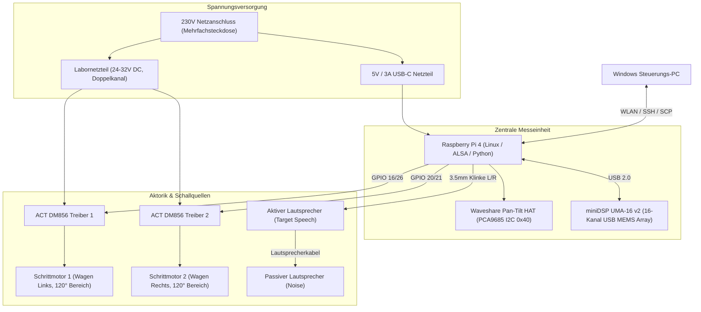

# Analyse, Inbetriebnahme und Workflow-Bericht des Aufnahmesystems

> **Projekt 04: Optimierung/Überarbeitung des Aufnahmesystems**  
> Modul: **PRO + SEM Assistenzsysteme** (HSNR – Fachbereich Elektrotechnik und Informatik)  
> Autoren: Chukwuekwugo Egbuonu (Kirito077) & Team  
> Referenz: Abschlussarbeit Yuxuan Li (2025) & Labor-Erprobung (November 2026)

---

## Inhaltsverzeichnis

1. [Einleitung & Zielsetzung](#1-einleitung--zielsetzung)
2. [Analyse der Abschlussarbeit & Systemaufbau (Ist-Zustand)](#2-analyse-der-abschlussarbeit--systemaufbau-ist-zustand)
3. [Detaillierter Erfahrungsbericht: Der Weg zur ersten Testaufnahme](#3-detaillierter-erfahrungsbericht-der-weg-zur-ersten-testaufnahme)
   - [3.1 Stromversorgung & die "Wattage-Falle" der Schrittmotoren](#31-stromversorgung--die-wattage-falle-der-schrittmotoren)
   - [3.2 Netzwerkanbindung & Remote-Zugriff (SSH / Hotspot)](#32-netzwerkanbindung--remote-zugriff-ssh--hotspot)
   - [3.3 Paketinstallation, I2C-Bus & UMA-16 Erkennung](#33-paketinstallation-i2c-bus--uma-16-erkennung)
   - [3.4 Anpassung der Altdaten & Skripte (Hardcoded Paths / SCP)](#34-anpassung-der-altdaten--skripte-hardcoded-paths--scp)
   - [3.5 Windows OpenSSH-Server & Berechtigungs-Fallstricke](#35-windows-openssh-server--berechtigungs-fallstricke)
   - [3.6 Motor-Fehlersuche & Signal-Kreuztest (GPIO 16/26 vs. 20/21)](#36-motor-fehlersuche--signal-kreuztest-gpio-1626-vs-2021)
   - [3.7 Erste automatisierte Testaufnahme & Datenübertragung](#37-erste-automatisierte-testaufnahme--datenübertragung)
4. [Ergebnisse der Live-Akkustik-Messung (12. November 2026)](#4-ergebnisse-der-live-akkustik-messung-12-november-2026)
   - [4.1 Mechanische Überlastung & Stepper-Schrittverluste](#41-mechanische-überlastung--stepper-schrittverluste)
   - [4.2 Akustisches Ungleichgewicht & 50-Meter-Kabeldämpfung](#42-akustisches-ungleichgewicht--50-meter-kabeldämpfung)
   - [4.3 Usability & CLI-Hürden](#43-usability--cli-hürden)
5. [Reibungsfreier Leitfaden: Raspberry Pi Schnellstart-Anleitung](#5-reibungsfreier-leitfaden-raspberry-pi-schnellstart-anleitung)
   - [Schritt 1: Hardware-Verkabelung & Einschaltreihenfolge](#schritt-1-hardware-verkabelung--einschaltreihenfolge)
   - [Schritt 2: PC-Vorbereitung (Mobiler Hotspot & OpenSSH)](#schritt-2-pc-vorbereitung-mobiler-hotspot--openssh)
   - [Schritt 3: SSH-Verbindung aufbauen](#schritt-3-ssh-verbindung-aufbauen)
   - [Schritt 4: System-Gesundheitsprüfung (One-Liner)](#schritt-4-system-gesundheitsprüfung-one-liner)
   - [Schritt 5: Testlauf & automatisierter Mess-Sweep](#schritt-5-testlauf--automatisierter-mess-sweep)
6. [Fazit & Nächste Projektschritte](#6-fazit--nächste-projektschritte)

---

## 1. Einleitung & Zielsetzung

Im Rahmen des Moduls **PRO + SEM Assistenzsysteme** an der Hochschule Niederrhein befasst sich das **Projekt 04** mit der Analyse, Optimierung und Überarbeitung eines bestehenden akustischen Aufnahmesystems. Das System dient zur automatisierten Erstellung von Mehrkanal-Audiodatensätzen für Richtmikrofon- (Beamforming) und Schallquellenlokalisierungs-Algorithmen (Direction of Arrival, DOA).

Dieses Dokument fasst zwei wesentliche Phasen zusammen:
1. Die theoretische Analyse der ursprünglichen Bachelor-Abschlussarbeit von Yuxuan Li (Hardwarearchitektur, Ansteuerung, Signalfluss).
2. Die praktische Inbetriebnahme des physikalischen Teststands im Labor inklusive aller aufgetretenen Fehler, Lösungswege, Messbeobachtungen (Test vom 12.11.2026) sowie einer optimierten Schritt-für-Schritt-Anleitung für nachfolgende Studierende.

---

## 2. Analyse der Abschlussarbeit & Systemaufbau (Ist-Zustand)

Das Aufnahmesystem von Yuxuan Li wurde konzipiert, um reproduzierbare Testbedingungen mit definierten Winkeln zwischen Schallquelle und Mikrofonarray zu schaffen:



### Komponenten-Spezifikationen:
* **Zentraler Rechner:** Raspberry Pi 4 Model B (4 GB RAM), Raspberry Pi OS (Debian 12 Bookworm / 64-bit).
* **Mikrofon-Array:** miniDSP UMA-16 v2 (16 synchron abgetastete MEMS-Mikrofone, USB-Audio Class 2.0, Abtastrate 48 kHz / 32-bit Float bzw. S32_LE).
* **Array-Orientierung:** Waveshare Pan-Tilt HAT (zwei Servos für Pan/Tilt über PCA9685 PWM-Treiber, angesteuert via I2C Bus 1 auf Adresse `0x40`).
* **Positionierungsantrieb:** 2× ACT Motor DM856 digitale Schrittmotortreiber, speisen zwei Schrittmotoren, die über 1,5 m lange Aluminiumstangen zwei fahrbare Lautsprecherwagen auf einer Kreisbahn führen.
* **Audio-Wiedergabe:** 3,5 mm Klinkenausgang des Raspberry Pi (bcm2835 Headphones). Kanal Links = Zielsprecher (LibriSpeech), Kanal Rechts = Störgeräusch (OMEETING / DEMAND).

---

## 3. Detaillierter Erfahrungsbericht: Der Weg zur ersten Testaufnahme

Die praktische Inbetriebnahme erforderte das Lösen mehrerer hardware- und softwareseitiger Hürden. Hier ist die detaillierte Chronologie:

### 3.1 Stromversorgung & die "Wattage-Falle" der Schrittmotoren
* **Problem:** Beim ersten Einschalten des Labornetzteils schaltete das Netzteil ab oder begrenzte die Spannung ("Max Wattage erreicht"), als versucht wurde, 32 V und 5 A gleichzeitig einzustellen.
* **Ursache & physikalische Erklärung:** Die ACT DM856 Treiber sind **Chopper-Schaltregler**. Sie wandeln die hohe Eingangsspannung (24–80 V) mit hohem Wirkungsgrad in die für die Motorwicklungen nötige Phasenspannung um. Ein Motor mit 4,2 A Phasenstrom benötigt pro Phase im Stillstand/langsamen Lauf nur ca. 15–30 W. Das Labornetzteil liefert bei 32 V und 2 Motoren im Normalbetrieb weniger als 1,0 bis 1,5 A pro Kanal. Die Einstellung von 32 V × 5 A = 160 W pro Kanal überlastete die Gesamtwattage-Begrenzung des Netzteil-Trafos.
* **Lösung:** 
  1. Netzteil-Ausgänge trennen.
  2. Spannung im CV-Modus (Constant Voltage) auf **24,0 V bis 28,0 V** einstellen.
  3. Strombegrenzung (CC) als Sicherheitsdecke auf **2,5 A bis 3,0 A** pro Kanal setzen.
  4. Die Schrittmotortreiber bleiben stabil im CV-Modus bei ca. 0,2–0,8 A Leerlaufruhestrom (Halbstrom-Absenkung aktiv).
  5. Der Raspberry Pi wird **niemals** über das Motornetzteil versorgt, sondern über sein eigenes 5V/3A USB-C Netzteil.

### 3.2 Netzwerkanbindung & Remote-Zugriff (SSH / Hotspot)
* **Problem:** Der Raspberry Pi sollte "Headless" (ohne Monitor/Tastatur) im Hochschullabor betrieben werden. Versuche, den Pi über das Universitäts-WLAN (eduroam / HSNR) zu verbinden, scheiterten an der 802.1X Enterprise-Authentifizierung und Client-Isolation. Zudem schlug die Namensauflösung via `raspberrypi.local` fehl, und SSH-Verbindungen brachen nach wenigen Minuten Inaktivität ab.
* **Fehlersuche & Lösungsschritte:**
  1. **Mobiler Hotspot:** Einrichtung eines 2,4 GHz Hotspots direkt auf dem Windows-Laptop (Name und Passwort identisch in `Raspberry Pi Imager` hinterlegt).
  2. **IPv6 Link-Local Timeout:** Windows versuchte oft, `raspberrypi.local` über IPv6 (`fe80::...%21`) aufzulösen, was in Timeouts endete. Lösung: Explizites Erzwingen von IPv4 mit `ssh -4 ami@raspberrypi.local` bzw. direkte Verwendung der numerischen IP aus den Windows-Hotspot-Einstellungen (z. B. `192.168.137.246`).
  3. **WLAN-Energiesparmodus deaktiviert:** Der Pi schaltete im Leerlauf das WLAN-Modul ab. Dauerhafte Deaktivierung über NetworkManager:
     ```bash
     sudo tee /etc/NetworkManager/conf.d/wifi-powersave.conf << 'EOF'
     [connection]
     wifi.powersave = 2
     EOF
     sudo systemctl restart NetworkManager
     ```

### 3.3 Paketinstallation, I2C-Bus & UMA-16 Erkennung
* **I2C Aktivierung:** Für den Waveshare Pan-Tilt HAT musste der I2C-Bus aktiviert werden:
  `sudo raspi-config nonint do_i2c 0`
  Prüfung via `i2cdetect -y 1` zeigte erfolgreich die Adresse `0x40` (PCA9685 PWM Servo-Controller) und `0x29` (TSL2581 Lichtsensor).
* **Python-Paket-Konflikt (PEP 668):** Bei Debian 12 (Bookworm) blockiert `pip install` systemweite Installationen ("externally-managed-environment").
  Lösung: Systempakete über apt installieren (`python3-soundfile`, `python3-numpy`, `python3-smbus2`, `python3-gpiozero`), Audio-Pakete notfalls mit `--break-system-packages` nachrüsten.
* **UMA-16 Hardware-Erkennung:**
  `arecord -l` bestätigte die Karte als `card 3: UMA16v2 [UMA16v2], device 0: USB Audio`.
  Testaufnahme mit `arecord -D hw:CARD=UMA16v2,DEV=0 -c 16 -r 48000 -f S32_LE test.wav` funktionierte einwandfrei.

### 3.4 Anpassung der Altdaten & Skripte (Hardcoded Paths / SCP)
In den Skripten des Vorautors (`main.py`, `realrecord_func.py`, `realrecord.py`) waren Pfade und IP-Adressen fest einprogrammiert:
* Altes System: `WINDOWS_USER = "lestileli"`, `WINDOWS_HOST = "192.168.200.220"`.
* Anpassung an aktuelles System:
  ```python
  WINDOWS_USER = "ekwug"
  WINDOWS_HOST = "192.168.137.1"  # Gateway-IP des Windows Hotspots
  TRANSFER_MODE = "ssh"           # War zuvor auf "usb" gestellt!
  WINDOWS_RECORDING_DIR = "Desktop/praktikum/audio/recordings"
  ```

### 3.5 Windows OpenSSH-Server & Berechtigungs-Fallstricke
Damit der Raspberry Pi nach jedem Messdurchlauf die Audio-Dateien und JSON-Metadaten vollautomatisch via `scp -o BatchMode=yes` auf den Windows-PC schieben kann, musste auf Windows der native OpenSSH-Server eingerichtet werden:
* **Dienst starten:** `Start-Service sshd` und `Set-Service -Name sshd -StartupType 'Automatic'`.
* **Schlüsselpaar auf Pi erzeugen:** `ssh-keygen -t ed25519` (ohne Passphrase).
* **Der "German Windows ACL Bug":** Unter Windows 10/11 führt das manuelle Hinzufügen des Schlüssels zu `administrators_authorized_keys` oft zu `Permission denied (publickey)`, weil Windows-Benutzer mit Admin-Rechten nicht die `~/.ssh/authorized_keys` nutzen, sondern die globale Admin-Datei, deren ACLs strikt gesichert sein müssen. Auf deutschen Windows-Versionen existiert die Gruppe "Administrators" nicht unter diesem Namen, sondern heißt "Administratoren".
* **Lösung mit sprachunabhängiger SID:**
  ```powershell
  $pubKey = "ssh-ed25519 AAAAC3NzaC1lZDI1NTE5AAAAIC5SC58K9X3xZ7P21a9TjptBrbUh3MWL/dUduUPauoo ami@raspberrypi"
  Set-Content -Force -Path "$env:ProgramData\ssh\administrators_authorized_keys" -Value $pubKey
  icacls.exe "$env:ProgramData\ssh\administrators_authorized_keys" /inheritance:r /grant "*S-1-5-32-544:F" /grant "SYSTEM:F"
  ```
* **Fingerprint bestätigen:** Einmaliger manueller Login vom Pi aus (`ssh ekwug@192.168.137.1`), um den Host-Fingerprint in `~/.ssh/known_hosts` abzuspeichern. Danach lief `BatchMode=yes` vollkommen autonom.

### 3.6 Motor-Fehlersuche & Signal-Kreuztest (GPIO 16/26 vs. 20/21)
* **Problem:** Beim Testen der Einzelschritt-Skripte (`python3 stepper.py` für Motor 1 und `python3 stepper2.py` für Motor 2) drehte sich nur Motor 2. Motor 1 gab keinen Mucks von sich.
* **Signal-Kreuztest:**
  1. Versorgungsspannung ausgeschaltet.
  2. Die PUL/DIR Steuerleitungen am Treiber von Motor 1 abgezogen und stattdessen an Treiber 2 angeschlossen (und umgekehrt).
  3. Beim Aufruf von `stepper2.py` bewegte sich nun der physische Motor 1!
* **Ergebnis:** Beide ACT DM856 Treiber, beide Motoren und beide Stromversorgungskanäle sind zu 100 % intakt. Der Fehler lag an einer lockeren Dupont-Steckverbindung bzw. falscher Pin-Belegung am Raspberry Pi GPIO-Header auf Pin 36 (GPIO 16) / Pin 37 (GPIO 26). Nach dem Nachdrücken und Bereinigen der Kontakte funktionierten beide Motoren.

### 3.7 Erste automatisierte Testaufnahme & Datenübertragung
Mit funktionierendem Netzwerk, SSH-Transfer und Audio-Routing wurde ein Testlauf über eine Einzelbedingung ausgeführt:
`python3 -c "import main; main.ttt.initialize(); main.initialize_stepper_references(); main.initialize_pan_reference(0); main.move_steppers_to(60, 60); main.record_current_condition(90, 60, 60)"`

* **Ablauf:**
  1. Pan-Tilt HAT fährt in Mittelstellung (90° mechanisch = 0° Dataset-Winkel).
  2. Beide Lautsprecherwagen erhalten Schritt-Impulse für 30° Winkeländerung (von 90° Startlinie auf 60°).
  3. 2-Sekunden Dummy-Warmup auf UMA-16 (Verwerfen des ALSA-Startpuffers).
  4. Synchrone Wiedergabe von 5 Sätzen LibriSpeech (Sprache) und OMEETING (Störgeräusch) über 3,5 mm Klinke.
  5. 16-Kanal-Aufnahme mit 48 kHz / 32-bit.
  6. Automatische Qualitätsprüfung (Clipping / Pufferüberlauf).
  7. Automatischer SCP-Transfer der 5 WAV-Dateien (je ca. 30–40 MB) + 5 `.metadata.json` Dateien auf den Windows-PC nach `C:\Users\ekwug\Desktop\praktikum\audio\recordings\...`.
  8. Lokale temporäre Dateien auf der SD-Karte werden gelöscht.

---

## 4. Ergebnisse der Live-Akkustik-Messung (12. November 2026)

Der sechsstündige Labortest am 12.11.2026 zeigte, dass die Software-Pipeline funktioniert, deckte jedoch **drei gravierende physikalische und mechanische Schwachstellen** auf:

### 4.1 Mechanische Überlastung & Stepper-Schrittverluste (Kritisch)
* **Beobachtung:** Beim Versuch, den 30°-Sweep (90° -> 60°) unter Last zu fahren, blockierten die Schrittmotoren mit lautem Rattern (Schrittverlust ähnlich einer durchrutschenden Akkuschrauber-Rutschkupplung). Die Lautsprecherwagen bewegten sich lediglich um 10 bis 20 mm statt des geforderten Kreisbogens von über 75 cm!
* **Ursachenanalyse:**
  1. **Biegung der 1,5 m Hebelarme:** Die Schrittmotoren sitzen im Zentrum und treiben 1,5 Meter lange Aluminiumrohre an, an deren Ende die schweren Lautsprecherwagen samt Rollen und Verkabelung hängen. Unter Last verbiegen sich die Rohre in der Mitte sichtbar. Das Drehmoment wird nicht steif auf die Räder übertragen.
  2. **Hohe Roll- und Haftreibung auf Teppich:** Der Versuchsraum besitzt einen Teppichboden ("Rug"). Die kleinen Rollen der Lautsprecherwagen sinken leicht ein. Die Haftreibung übersteigt zusammen mit dem Biegemoment der Stangen das Haltemoment der Schrittmotoren bei weitem.
  3. **12 V vs. 24 V:** Das Netzteil lieferte während dieses Teiltests zeitweise nur 12 V an die Treiber. Bei 12 V sinkt die Drehmomentkurve von Schrittmotoren bei höheren Schrittfrequenzen drastisch ab.

### 4.2 Akustisches Ungleichgewicht & 50-Meter-Kabeldämpfung
* **Beobachtung:** Der aktive Hauptlautsprecher (L) war deutlich lauter als der passive Sekundärlautsprecher (R). Darüber hinaus war selbst der Hauptlautsprecher insgesamt leiser als für realistische SNR-Szenarien erforderlich.
* **Ursachenanalyse:**
  * Obwohl der Versuchsaufbau einen Durchmesser von lediglich 3 bis maximal 5 Metern hat, ist zwischen dem primären und sekundären Lautsprecher ein **schätzungsweise 30 bis 50 Meter langes Lautsprecherkabel** aufgewickelt und verlegt!
  * Der ohmsche Leitungswiderstand und die induktive Dämpfung dieser extremen Kabelschleife vernichten einen Großteil der Audioleistung für den passiven Lautsprecher.

### 4.3 Usability & CLI-Hürden
* **Beobachtung:** Die manuelle Bedienung über mehrere SSH-Terminals, manuelle Skriptaufrufe und IP-Überwachungen ist fehleranfällig, extrem stressig und für Dritte nicht reproduzierbar.
* **Forderung:** Das System benötigt eine eigenständige grafische Benutzeroberfläche (Web-GUI / Streamlit / lokale Desktop-App), die Verbindungsstatus, Ausrichtung, Pegelanzeige und Sweep-Ausführung auf Knopfdruck bündelt.

---

## 5. Reibungsfreier Leitfaden: Raspberry Pi Schnellstart-Anleitung

Damit nachfolgende Teammitglieder oder Projektbetreuer den Prüfstand **ohne Vorkenntnisse und mit minimaler Reibung** in Betrieb nehmen können, ist folgende Schritt-für-Schritt-Prozedur einzuhalten:

### Schritt 1: Hardware-Verkabelung & Einschaltreihenfolge
1. **Zentrierung:** Grundplatte aufstellen. Sicherstellen, dass im Radius von 1,6 m um das Zentrum keine Hindernisse stehen.
2. **Kabelkontrolle:** UMA-16 Array per USB mit dem Pi verbinden. Klinkenkabel vom Pi (3,5 mm) in den aktiven Lautsprecher stecken.
3. **Lautsprecherwagen manuell ausrichten:** Bei **ausgeschaltetem** Motornetzteil beide Lautsprecherwagen von Hand exakt auf die 90°-Markierungslinie (senkrecht vor das Mikrofon-Array) schieben.
4. **Motornetzteil einschalten:**
   * Spannung: **24,0 V DC** (Kanal 1 & Kanal 2 unabhängig / INDEP).
   * Strombegrenzung: **2,5 A** pro Kanal.
   * Grüne PWR-LEDs an den DM856-Treibern leuchten; Motoren sperren nun mit Haltemoment.
5. **Raspberry Pi booten:** USB-C Netzteil in die Steckdose stecken. (Grüne LED flackert = Bootvorgang läuft).

### Schritt 2: PC-Vorbereitung (Mobiler Hotspot & OpenSSH)
1. **Windows Mobiler Hotspot einschalten:**
   * `Windows-Taste + I` -> **Netzwerk und Internet** -> **Mobiler Hotspot** auf **Ein**.
   * Netzband: **2,4 GHz** (oder "Beliebig").
   * Energiesparmodus des Hotspots: **Aus** ("Wenn keine Geräte verbunden sind, nicht ausschalten").
2. **OpenSSH Server Status prüfen (PowerShell als Admin):**
   ```powershell
   Get-Service sshd | Start-Service
   ```

### Schritt 3: SSH-Verbindung aufbauen
1. In den Windows-Hotspot-Einstellungen nach ca. 60 Sekunden die zugewiesene IPv4-Adresse des Raspberry Pi ablesen (z. B. `192.168.137.246`).
2. PowerShell öffnen und verbinden:
   ```powershell
   ssh -4 ami@192.168.137.246
   # Passwort: (Standard-Projektpasswort)
   ```

### Schritt 4: System-Gesundheitsprüfung (One-Liner)
Im SSH-Terminal folgenden Einzeiler ausführen, um alle Sensoren, Aktoren und Audiointerfaces gleichzeitig zu validieren:

```bash
i2cdetect -y 1 && arecord -l | grep UMA16 && aplay -l | grep Headphones
```
* **Erwartete Ausgabe:**
  * I2C-Grid zeigt Adresse `40` (Pan-Tilt HAT).
  * `arecord` listet `card 3: UMA16v2`.
  * `aplay` listet `card 2: Headphones` (bcm2835).

### Schritt 5: Testlauf & automatisierter Mess-Sweep

#### A. Servos zentrieren & 0°-Referenz anfahren
```bash
python3 -c "import sys; sys.path.insert(0, '/home/ami/Pan-Tilt_HAT_code/RaspberryPi/Servo_Driver/python'); import ttt; ttt.initialize(); ttt.pwm.setRotationAngle(0, 90)"
```
*Das UMA-16 Array richtet sich exakt geradeaus (0° akustische Achse) aus.*

#### B. Einen 1-Bedingungs-Testlauf durchführen (ca. 90 Sekunden)
```bash
cd /home/ami/testcode
python3 -c "import main; main.ttt.initialize(); main.initialize_stepper_references(); main.initialize_pan_reference(0); main.move_steppers_to(60, 60); main.record_current_condition(90, 60, 60); main.ttt.cleanup(return_to_initial=False)"
```
*Die Daten werden sofort aufgenommen, verifiziert und automatisch auf Ihren Windows-Desktop unter `Desktop\praktikum\audio\recordings` übertragen.*

#### C. Vollständigen 75-Bedingungen Sweep im Hintergrund ausführen (ca. 2 Stunden)
Damit ein Verbindungsabbruch des Laptops die Messung nicht abbricht, immer mit `nohup` starten:
```bash
cd /home/ami/testcode
nohup python3 -u main.py > sweep_run.log 2>&1 &
# Fortschritt live mitverfolgen:
tail -f sweep_run.log
```

---

## 6. Fazit & Nächste Projektschritte

Die Software- und Kommunikationskette (Raspberry Pi <-> UMA-16 <-> Pan-Tilt <-> Windows OpenSSH Auto-Transfer) ist **vollständig funktionsfähig und verifiziert**.

Die Prioritäten für die hardwareseitige Optimierung im Rahmen von Projekt 04 lauten:
1. **Lautsprecher-Verkabelung kürzen:** Austausch des 50 m Kabels gegen ein 4 m langes, geschirmtes Lautsprecherkabel (mindestens 1,5 mm² Querschnitt) zur Beseitigung der Pegeldifferenz.
2. **Mechanische Entlastung der Schrittmotoren:**
   * Erhöhung der Versorgungsspannung auf stabile 24–32 V.
   * Entweder Versteifung der 1,5 m Stangen durch CFK-Profile / Dreiecks-Fachwerk ODER Umstellung auf aktiv angetriebene Lautsprecherwagen mit Eigenantrieb auf den Rädern.
3. **Entwicklung eines Web-Dashboards (GUI):** Ersatz der CLI-Bedienung durch ein leichtgewichtiges Browser-Interface zur visuellen Steuerung für Nicht-Programmierer.
