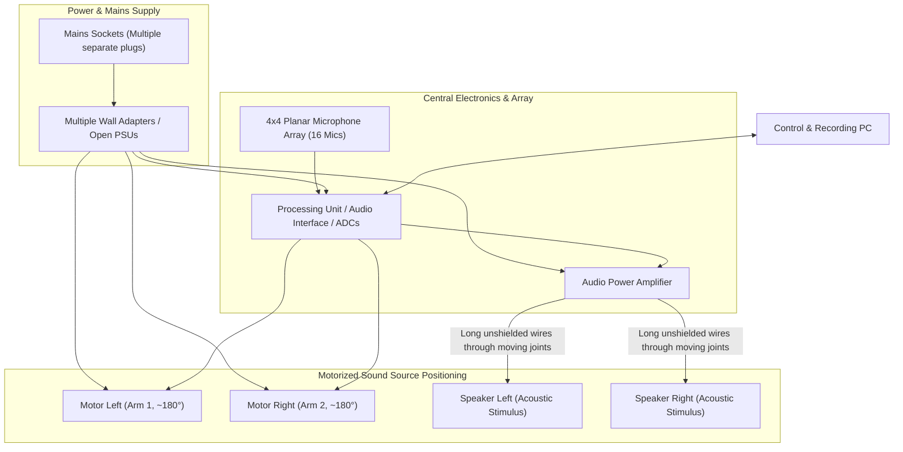
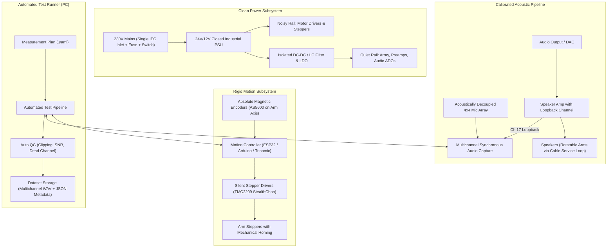

# MIC-Array: Optimierung und Überarbeitung des Aufnahmesystems

> **Projekt 04: Optimierung/Überarbeitung des Aufnahmesystems**
> Modul: **PRO + SEM Assistenzsysteme** (Dozenten: Prof. Dr. Nitsche, Prof. Dr. Naroska)  
> Hochschule Niederrhein (HSNR) – Fachbereich Elektrotechnik und Informatik – 5. Semester

| Field | Value |
|---|---|
| **Project Name** | Mikrofone Array |
| **Official Topic** | **Projekt 04: Optimierung/Überarbeitung des Aufnahmesystems** |
| **Module** | PRO + SEM Assistenzsysteme (Projekt + Seminar) |
| **Supervisors** | Prof. Dr. Nitsche, Prof. Dr. Naroska |
| **Author** | Chukwuekwugo Egbuonu |
| **Team Members** | *TBD: To be confirmed with supervisors/team* |
| **Documentation Start** | 2026-10-29 |
| **Current Stage** | Stage 2: Baseline-Messungen & Verifikation (Live-Labortests & Schwachstellenanalyse) |
| **Status** | Active |
| **Last Updated** | 2026-11-16 |

---

## Table of Contents

1. [Project Overview & Official Task](#1-project-overview--official-task)
2. [Course Context & Assessment](#2-course-context--assessment)
3. [Existing System Description (Ist-Zustand)](#3-existing-system-description-ist-zustand)
4. [Identified Weak Points & Challenges](#4-identified-weak-points--challenges)
5. [Improvement Concept & Target Architecture](#5-improvement-concept--target-architecture)
6. [Baseline Test Plan (T1–T7)](#6-baseline-test-plan-t1t7)
7. [Project Stages & Roadmap](#7-project-stages--roadmap)
8. [Project Log (Chronological Entries)](#8-project-log-chronological-entries)
9. [Difficulties and Solutions](#9-difficulties-and-solutions)
10. [Decision Register](#10-decision-register)
11. [Open Questions & Lab Checklist](#11-open-questions--lab-checklist)
12. [Repository Structure](#12-repository-structure)
13. [References & Related Documents](#13-references--related-documents)
14. [How to Update This README](#14-how-to-update-this-readme)

---

## 1. Project Overview & Official Task

### 1.1 Official Task Description (Wahlfach-Katalog) ✅

> **Projekt 04: Optimierung/Überarbeitung des Aufnahmesystems**  
> In dem Projekt soll das bisherige Aufnahmesystem hinsichtlich seiner Eigenschaften analysiert, Schwachpunkte identifiziert und durch passende Überarbeitungen verbessert werden. Das kann dabei sowohl Verbesserungen in der **Mechanik**, **Elektronik** als auch der **Ansteuer-Software** umfassen.

### 1.2 Core Tasks & Objectives (Aufgaben und Ziele) ✅

1. **Hardware und Software analysieren:** Vollständige Bestandsaufnahme der mechanischen Komponenten, Elektronikplatinen, Verkabelung, Signalwege und der bestehenden Steuerungssoftware.
2. **Zusätzliche Testaufnahmen erzeugen und auswerten:** Erstellung eines Satzes reproduzierbarer Referenzaufnahmen (Ground Truth) zur Bestimmung von Rauschabstand, Pegelgleichheit, Phasenverhalten und Winkelgenauigkeit vor Umbauarbeiten.
3. **Schwachpunkte des aktuellen Systems identifizieren:** Detaillierte Analyse aller Bottlenecks – insbesondere im Hinblick auf einen **„produktiven“ Einsatz** des Systems (Labordemos, robuste Datensatz-Erzeugung, einfache Bedienbarkeit).
4. **Verbesserungsvorschläge erarbeiten:** Konzeptionierung gezielter Maßnahmen gegliedert nach Aufwand (Quick Wins, mittlere Maßnahmen, größerer Rework).
5. **Verbesserungen implementieren:** Praktische Umsetzung ausgewählter Verbesserungen an Mechanik, Verkabelung, Spannungsversorgung und Software-Steuerung.
6. **Dokumentieren der Ergebnisse:** Lückenlose Erfassung des Vorher/Nachher-Vergleichs, der technischen Spezifikationen und einer Betriebsanleitung für Folgegruppen.

---

## 2. Course Context & Assessment

### 2.1 Module Framework (HSNR) ✅

| Parameter | Details |
|---|---|
| **Module** | PRO / SEM / PRO+SEM für BIN, BET, BMT |
| **Seminar Meetings** | Tuesdays, 14:15–15:45, Room B 120 |
| **Project Meetings** | By individual agreement with supervisors (Nitsche, Naroska) |
| **Assessment: Seminar** | Presentation / Vortrag (30 min) + written paper (Ausarbeitung) |
| **Assessment: Project** | Project work + written documentation / Ausarbeitung (+ optional demo/talk) |
| **Grading** | BI: Pass/Fail (ohne Note); BE / BMT: Graded (mit Note) |

### 2.2 Synergies with Seminar Topics ✅

The following topics from the seminar syllabus directly support this project:
- **Speech recognition / STT (Speech-to-Text):** State of the art and benchmarks using directional array audio.
- **Far-field audio capture:** Commercial architectures (Alexa, Siri, smart conference bars).
- **Sensor systems for robotics & smart environments:** Integrating array audio into assistant systems (e.g., Ruby, RuhrBots).
- **Hardware acceleration for signal processing / AI audio filters.**

---

## 3. Existing System Description (Ist-Zustand)

The recording setup is an acoustic measurement testbed designed to place sound sources at defined angular positions around a microphone array to test beamforming and Direction of Arrival (DOA) algorithms.



### 3.1 Subsystem Breakdown (Confirmed via Abschlussarbeit Yuxuan Li ✅)

| Subsystem | Verified Hardware Component | Technical Specifications & Status |
|---|---|---|
| **Microphone Array** | **miniDSP UMA-16** (USB Multichannel Array) | 16 digital MEMS microphones in a 4×4 planar grid ($d = 43\text{ mm}$ pitch). USB audio stream sampled via Linux ALSA. |
| **Array Mounting** | 2-DOF Pan-Tilt Servo Kit on wooden base | Two miniature hobby servos (horizontal pan + vertical tilt). **Defect:** Servos lack holding torque when unpowered; array sags downward under its own weight. |
| **Central Controller** | **Raspberry Pi** | Mounted centrally beneath array pan-tilt mechanism on wooden base plate. Generates GPIO pulse/direction for stepper drivers and servo PWM. Controlled remotely via VNC/SSH from PC. |
| **Acoustic Stimulus** | 2× Active Speakers on Wheeled Carts | Speakers mounted on two carts rolling on the floor at a 1.5 m radius ($l \approx 1.5\text{ m}$). One speaker outputs target speech, the second outputs directional noise. |
| **Positioning Mechanics** | 2× Stepper Motors (3 Nm, 8 mm D-shaft) | Drive 1.5 m smooth steel rods connected to carts. **Defect:** Motor shafts are offset from array symmetry axis (center-of-rotation error), and rod flexion introduces angular hysteresis. |
| **Motor Drivers & Power** | **ACT DM856** Digital Stepper Drivers | Industrial microstepping drivers (24–80 V input, up to 4.2 A) powered by dedicated high-voltage PSU. Separate mains wall adapters for Raspberry Pi, PC, and speakers. |
| **Cabling & Floor Space** | Exposed Floor Wiring Harnesses | Mains and DC lines running from center along ground plane. **Defect:** Artificially restricted arm travel from 180° to 120° specifically to prevent carts from running over cables. |
| **Acquisition Software** | Python Scripts via ALSA & RPi.GPIO | Sequential python execution: move cart -> wait -> start speaker playback -> trigger 16-ch ALSA record -> save WAV. Lacks automated quality control and closed-loop position verification. |

---

## 4. Identified Weak Points & Challenges

Based on the preliminary system analysis ([`docs/01_initial_improvement_suggestions.md`](docs/01_initial_improvement_suggestions.md)), 21 specific weak points were categorized across three domains:

### 4.1 Mechanics

- **[W-M1] Cable Stress in Moving Joints:** Speaker and sensor lines bend directly at the arm pivot. Fatigue leads to intermittent audio cutouts or broken conductors.
- **[W-M2] Angular Repeatability & Ground Truth:** Without homing end-stops or absolute position encoders, motor backlash (±2°–5°) leads to systematic labeling errors in ground truth angles.
- **[W-M3] Mechanical Vibration & Structure-Borne Noise:** Motor holding torque and mechanical vibration travel through the frame directly into the microphone array.
- **[W-M4] Acoustic Reflections & Shadowing:** Electronics enclosures, motor housings, and bulky arm profiles near the array create acoustic scattering and multipath artifacts.
- **[W-M5] Near-Field vs. Far-Field Geometry:** If speaker arms are shorter than the Rayleigh distance ($r_{ff} \approx 2D^2/\lambda$), spherical wave propagation must be modeled rather than plane waves.
- **[W-M6] Cable Tangle Range Restriction:** Cables leading out from the center forced the creator to artificially constrain arm travel from 180° down to 120° so the wheeled carts wouldn't crush power cords.
- **[W-M7] Lack of Portability:** Fragile exposed wiring, 1.5 m steel rods, and a heavy wooden base make transport between labs impractical.
- **[W-M8] Center-of-Rotation Offset (Confirmed via Li Thesis):** The two stepper motors are mounted off-axis from the array's acoustic center, creating a non-linear geometric discrepancy between motor shaft angle and true angle-of-arrival.
- **[W-M9] Rod Flexion & Floor Rolling Resistance (Confirmed via Li Thesis):** The 1.5 m smooth rods flex under wheel rolling resistance and cart inertia, causing angular lag/hysteresis between commanded motor steps and true speaker position.
- **[W-M10] Pan-Tilt Servo Sagging (Confirmed via Li Thesis):** The hobby servos in the 2-DOF camera tilt mount lack unpowered holding torque and sag under the weight of the miniDSP UMA-16 array.

### 4.2 Electronics & Power

- **[W-E1] Multiple Mains Plugs & Ground Loops:** Separate power supplies create ground potential differences, inducing 50 Hz hum and harmonics into the 16-channel recording.
- **[W-E2] Electrical Safety in Student Labs:** Open 230 V wiring or uncertified adapters represent safety hazards. Requires single fused, switched inlet.
- **[W-E3] Electromagnetic Interference (EMI):** Stepper motor PWM drivers and switch-mode supplies placed adjacent to unshielded microphone lines couple high-frequency noise.
- **[W-E4] Signal Integrity over Flexible Leads:** Long digital/analog mic runs without differential drivers or proper shielding degrade high-frequency response.
- **[W-E5] Unlabeled / Soldered Point-to-Point Wiring:** Lack of keyed, labeled connectors prevents modular troubleshooting and rapid maintenance.
- **[W-E6] Missing Hardware Emergency Stop:** No accessible kill switch to cut motor power during mechanical stalls or limit overruns.
- **[W-E7] Inter-Channel Gain & Phase Dispersion:** Uncalibrated channel tolerances degrade beamformer directivity index and DOA accuracy.
- **[W-E8] Playback-to-Capture Clock Drift:** Asynchronous playback and recording clocks prevent exact phase-aligned impulse response extraction.

### 4.3 Control & Acquisition Software

- **[W-S1] Disjointed Workflow:** Motor positioning and recording triggering are operated manually, preventing automated sweeps.
- **[W-S2] Missing Recording Metadata:** Audio files lack embedded or sidecar JSON metadata (commanded angle, measured angle, stimulus, gain, temperature).
- **[W-S3] Hard-Coded System Parameters:** Pinouts, com ports, and calibrations hard-coded in source files.
- **[W-S4] Absence of Live Quality Control (QC):** No automated detection of clipping, dead channels, or excessive background noise prior to saving.
- **[W-S5] Missing Software Limit Enforcement:** Software does not track soft limits or verify homing state before commanding arm travel.
- **[W-S6] Sparse Dependency Documentation:** Lack of lockfiles (`pyproject.toml`, `uv.lock`) complicates handover to succeeding student groups.

---

## 5. Improvement Concept & Target Architecture



### 5.1 Prioritized Action Items

1. **Quick Wins (Days):**
   - Single fused IEC power strip / box to kill ground loops.
   - Spiral cable wrapping, strain reliefs, and labeled service loops at arm joints.
   - Software Stop–Settle–Record sequence (wait 500–1000 ms after motor stops before capture).
   - Sidecar `.json` metadata generation for every saved `.wav`.
2. **Medium Effort (Weeks):**
   - Keyed aviation plugs (GX12/GX16) for detachable motors and speakers.
   - TMC2209 silent stepper drivers with holding current reduction during acoustic capture.
   - Microswitch/Hall homing end-stops and AS5600 absolute angle encoders.
   - Dedicated loopback audio channel for automated clock-drift and latency correction.
   - Automated test runner script executing full multi-angle sweeps.
3. **Larger Rework (Optional / Future Scope):**
   - Slip-ring assemblies at arm pivots for continuous 360° rotation.
   - Aerodynamic/acoustic damping on arm profiles to eliminate reflection artifacts.

---

## 6. Baseline Test Plan (T1–T7)

To ensure scientific rigor, all improvements must be benchmarked against **quantitative baseline measurements** conducted on the unmodified setup:

| Test ID | Test Name | Execution Method | Measured Metrics & Target |
|---|---|---|---|
| **T1** | Noise Floor Ladder | 30 s silence recordings in 4 states: (a) idle, (b) PSUs on, (c) motors holding, (d) motors moving. | FFT noise spectrum, 50 Hz hum level, motor switching EMI. |
| **T2** | Channel Balance Check | Broadside sine sweep from far field. | Inter-channel gain mismatch (dB) and phase variance (deg). |
| **T3** | Mechanical Repeatability | Approach angles (0°, 45°, 90°, 135°) 10x from CW and CCW directions. | Angular hysteresis and error (measured via digital protractor / laser). |
| **T4** | Acoustic DOA Accuracy | Run GCC-PHAT / SRP-PHAT algorithm across angles. | Angular localization error ($\Delta \theta = |\theta_{cmd} - \theta_{est}|$). |
| **T5** | Structural Reflection Check | Exponential sine sweep impulse response with arm present vs. absent. | Echo density, early reflection distortion from mechanics. |
| **T6** | Loopback Latency Check | Loop stimulus into reference input. | Clock jitter, latency variance across consecutive runs. |
| **T7** | Setup & Operational Time | Time from unpacking/powering on to first valid recording. | Operational usability benchmark for students. |

---

## 7. Project Stages & Roadmap


| Stage | Name | Key Milestones | Status |
|---|---|---|---|
| **Stage 1** | Ist-Analyse & Bestandsaufnahme | Physical inspection, photo documentation, pinout/schematic mapping, weak point classification. | 🟡 In Progress |
| **Stage 2** | Baseline-Messungen (T1–T7) | Execution of tests T1 through T7 on existing hardware; establishing "Before" dataset. | ⏳ Planned |
| **Stage 3** | Detailkonzept & Bauteilauswahl | Selection of connectors, power supplies, TMC drivers, encoders; procurement BOM. | ⏳ Planned |
| **Stage 4** | Umbau & Optimierung Hardware | Single power entry, cable routing, joint strain relief, acoustic dampening, sensor integration. | ⏳ Planned |
| **Stage 5** | Software-Automatisierung | Development of unified Python test runner, metadata generator, automated angle sweeps. | ⏳ Planned |
| **Stage 6** | Verifikation, Vergleich & Ausarbeitung | Rerun of tests T1–T7 ("After" dataset), report writing (*Ausarbeitung*), final presentation. | ⏳ Planned |

---

## 8. Project Log (Chronological Entries)

### Entry #001: 2026-10-29: Initial Repository Setup
**Stage:** Stage 0: Setup & Repository Initialization  
**Author:** Chukwuekwugo Egbuonu (Assisted by Antigravity AI)

**Summary:**
- Created initial repository structure under `5.Semester/Assystenz system/Mikrofone Array/`.
- Extracted course syllabus from `Seminar/Wahlfach-Vorstellung- Pro+Sem-Assistenzsysteme.pdf`.
- Established baseline documentation framework with log templates and decision registers.

---

### Entry #002: 2026-10-29: Scope Refinement to Projekt 04
**Stage:** Stage 1: Ist-Analyse  
**Author:** Chukwuekwugo Egbuonu (Assisted by Antigravity AI)

**Summary:**
- Clarified that the project is an optimization of an **existing HSNR recording testbed** (Projekt 04: *Optimierung/Überarbeitung des Aufnahmesystems*), not a new microphone array build from scratch.
- Captured preliminary hardware details from memory: central 4×4 planar microphone array, two motorized speaker arms rotating ~180°, direct mains wiring, multiple separate power adapters.
- Created technical suggestions and weak-point catalog in [`docs/01_initial_improvement_suggestions.md`](docs/01_initial_improvement_suggestions.md).

---

### Entry #003: 2026-10-29: Conversation Alignment & Scope Confirmation
**Stage:** Stage 1: Ist-Analyse  
**Author:** Chukwuekwugo Egbuonu (Assisted by Antigravity AI)

**Summary:**
- Integrated complete context from conversation `827528fc-fa92-4104-a997-63ae076fc52a`.
- Replaced preliminary new-build documentation in `README.md` with the dedicated Projekt 04 documentation.
- Embedded complete 21-point weakness taxonomy, T1–T7 verification plan, and power/motion target architecture into the master README.
- Verified background scheduling configuration for automated daily README updates at 08:00 AM Europe/Berlin.

**Next Steps:**
- [ ] Next laboratory session: Complete photo documentation and measure physical array dimensions (Checklist §11).
- [ ] Obtain existing control scripts and sample audio data from lab workstation.
- [ ] Review baseline measurement schedule with Prof. Dr. Nitsche / Prof. Dr. Naroska.

---

### Entry #004: 2026-11-01: Daily Master Documentation Update (Iteration 1)
**Stage:** Stage 1: Ist-Analyse & Konzepterweiterung  
**Author:** Antigravity AI Assistant (Automated Daily 08:00 AM CET Cron)

**Summary:**
- **Acoustic & Wireless Analysis of Mobile Bluetooth Speaker Concept:**
  - Evaluated the user's architectural proposal to replace fixed mechanical motor arms with autonomous mobile speaker rovers.
  - Determined that consumer Bluetooth (A2DP) is unsuitable for acoustic array measurement due to 100–250 ms variable packet latency (±15 ms buffer jitter), dual-speaker crystal drift, and lossy compression (SBC/AAC) distorting high-frequency phase coherence.
  - Designed a high-fidelity wireless alternative: on-board uncompressed `.wav` playback (microSD + I²S DAC on an ESP32 rover) triggered via Wi-Fi/ESP-NOW, paired with an ultrasonic acoustic sync chirp (18 kHz Barker code) for microsecond-precise arrival time ($t_0$) calibration.
- **Microphone Array Geometry Trade-off Study (4×4 Planar Grid vs. 16-element Circular Array):**
  - Conducted a comparative analysis between the existing 16-element 4×4 planar grid and a uniform circular array (UCA).
  - 4×4 Planar Array: Enables 3D beamforming (azimuth + elevation) and acoustic camera imaging; disadvantage is non-uniform horizontal symmetry and front/back ambiguity without backing.
  - 16-element Circular Array: Provides 360° horizontal isotropy and maximum aperture for horizontal DOA; disadvantage is complete loss of elevation resolution and the need to fabricate a new PCB.
  - Confirmed DEC-008: Retain the existing 4×4 array for the physical optimization of Projekt 04, while using the circular array comparative derivation in the seminar talk and written paper.
- **Infrastructure & Automation Health Check:**
  - Verified background cron daemon (`task-94`) execution at 08:00 AM CET.
  - Updated Decision Register with DEC-008 and DEC-009, and logged incident D-005 in Difficulties and Solutions.

**Next Steps:**
- [ ] On-site lab session: capture detailed photos of central electronics, motor joints, and wiring harnesses.
- [ ] Record hardware part numbers (microphones, ADCs, microcontrollers, motor drivers).
- [ ] Perform baseline test T1 (Noise Floor Ladder) once access to the lab rig is scheduled.

---

### Entry #005: 2026-11-02: Daily Master Documentation Update (Iteration 2)
**Stage:** Stage 1: Ist-Analyse & Seminar-Vorbereitung  
**Author:** Antigravity AI Assistant (Automated Daily 08:00 AM CET Cron)

**Summary:**
- **Daily Workspace & Repository Audit:**
  - Audited repository files under `Assystenz system/Mikrofone Array/`. All conceptual and analysis documentation remains verified and stable.
  - Current operational stage remains confirmed at **Stage 1 (Ist-Analyse & Bestandsaufnahme)** pending physical hardware inspection.
- **Seminar & Supervisor Milestone Preparation (Tuesday Session):**
  - Prepared briefing focus for the upcoming seminar session (Tuesday, Nov 3, 14:15–15:45, Room B 120):
    1. Scope alignment on Projekt 04: Present the 21-point weakness classification and baseline measurement protocol (T1–T7) to Prof. Dr. Nitsche and Prof. Dr. Naroska.
    2. Review open questions (§11.1): Hardware budget for components (closed PSU, silent stepper drivers, keyed connectors, AS5600 encoders), laboratory electrical safety protocol for 230 V consolidation, and location/access credentials for the legacy control software repository.
    3. Coordinate lab access schedule to capture on-site photographs and run baseline test T1 (Noise Floor Ladder).
- **Automation Health:**
  - Verified cron schedule `task-94` running autonomously on iteration 2.

**Next Steps:**
- [ ] Attend seminar session on Tuesday (Room B 120) and review questions (§11.1) with supervisors.
- [ ] Obtain physical lab access to inspect the 4×4 array rig and retrieve the existing codebase.
- [ ] Perform baseline measurement T1 (Noise Floor Ladder) once the rig is powered.

---

### Entry #006: 2026-11-05: Daily Master Documentation Update (Iteration 1 on Task-153)
**Stage:** Stage 1: Ist-Analyse & Task-Wiederaufnahme  
**Author:** Antigravity AI Assistant (Automated Daily 08:00 AM CET Cron)

**Summary:**
- **Infrastructure Audit & Task Re-Registration:**
  - Audited conversation events following the 2026-11-04 server restart (18:39 UTC).
  - Re-established the active daily master documentation cron as daemon schedule `task-153` (`0 7 * * *`, daily at 08:00 AM CET).
  - Verified conversation task status and standing cron execution.
- **Project Progress & Operational Status:**
  - Workspace file tree audited; no new files or external data deposited yet.
  - Project remains in **Stage 1 (Ist-Analyse & Schwachstellenidentifikation)** awaiting the user's return from the seminar session with physical rig inspection notes, hardware photos, and legacy software scripts.
  - Documented difficulty `D-006` in Section 9.

**Next Steps:**
- [ ] Ingest hardware photos and component part numbers once uploaded by the user.
- [ ] Review feedback from supervisors (Prof. Dr. Nitsche, Prof. Dr. Naroska) regarding budget and lab access.
- [ ] Prepare python script for Baseline Test T1 (Noise Floor Ladder) once array hardware specifications are known.

---

---

### Entry #007: 2026-11-06: Daily Master Documentation Update (Iteration 2 on Task-153)
**Stage:** Stage 1: Ist-Analyse & Vorbereitung Baseline-Messungen  
**Author:** Antigravity AI Assistant (Automated Daily 08:00 AM CET Cron)

**Summary:**
- **Daily Workspace & Repository Audit:**
  - Audited repository files under `Assystenz system/Mikrofone Array/`. File structures and documentation remain stable and verified.
  - Operational stage remains at **Stage 1 (Ist-Analyse & Bestandsaufnahme)** pending upload of physical testbed photographs and component identification data.
- **Project Tracking & Milestone Readiness:**
  - Confirmed ongoing readiness for Baseline Test Plan execution (T1–T7) as documented in Section 6.
  - Maintained tracking of open supervisor questions (§11.1) regarding budget allocation, lab electrical safety standards, and codebase access.
- **Automation Health:**
  - Verified daemon cron schedule `task-153` (`0 7 * * *`) executing reliably at 08:00 AM CET.

**Next Steps:**
- [ ] Ingest hardware photos and component part numbers once uploaded by the user.
- [ ] Review feedback from supervisors (Prof. Dr. Nitsche, Prof. Dr. Naroska) regarding budget and lab access.
- [ ] Prepare python script for Baseline Test T1 (Noise Floor Ladder) once array hardware specifications are known.

---

---

### Entry #008: 2026-11-07: Daily Master Documentation Update (Iteration 3 on Task-153)
**Stage:** Stage 1: Ist-Analyse & Vorbereitung Baseline-Messungen  
**Author:** Antigravity AI Assistant (Automated Daily 08:00 AM CET Cron)

**Summary:**
- **Daily Workspace & Repository Audit:**
  - Audited repository files under `Assystenz system/Mikrofone Array/`. All documentation files (`README.md`, `docs/01_initial_improvement_suggestions.md`) verified intact.
  - Operational stage remains at **Stage 1 (Ist-Analyse & Bestandsaufnahme)**.
- **Weekend Milestone & Hardware Ingestion Status:**
  - System stands ready to ingest hardware photographs, exact component model identifiers (mic breakout boards, ADC interface, motor drivers), and physical frame measurements once collected from the lab.
  - Test protocol T1 (Noise Floor Ladder) pre-structured for immediate execution upon rig power-up.
- **Automation Health:**
  - Verified daemon cron schedule `task-153` (`0 7 * * *`) executing reliably at 08:00 AM CET (Iteration 3).

**Next Steps:**
- [ ] Ingest hardware photos and component part numbers once uploaded by the user.
- [ ] Review feedback from supervisors (Prof. Dr. Nitsche, Prof. Dr. Naroska) regarding budget and lab access.
- [ ] Prepare python script for Baseline Test T1 (Noise Floor Ladder) once array hardware specifications are known.

---

---

### Entry #009: 2026-11-08: Daily Master Documentation Update (Iteration 1 on Task-247)
**Stage:** Stage 1: Ist-Analyse & Task-Wiederaufnahme  
**Author:** Antigravity AI Assistant (Automated Daily 08:00 AM CET Cron)

**Summary:**
- **Infrastructure Audit & Task-247 Verification:**
  - Audited events following the 2026-11-07 evening server restart (21:23 UTC).
  - Confirmed daily documentation cron re-established under daemon schedule `task-247` (`0 7 * * *`, daily at 08:00 AM CET).
  - Verified task status and confirmed standing daily documentation cron schedule `task-247`.
  - Documented incident `D-007` in Section 9.
- **Project Progress & Operational Status:**
  - Workspace file tree audited; no new files or external data deposited yet.
  - Operational stage remains at **Stage 1 (Ist-Analyse & Bestandsaufnahme)**.
  - All baseline testing protocols (T1–T7) and supervisor consultation items (§11.1) remain ready for upcoming lab sessions.

**Next Steps:**
- [ ] Ingest hardware photos and component part numbers once uploaded by the user.
- [ ] Review feedback from supervisors (Prof. Dr. Nitsche, Prof. Dr. Naroska) regarding budget and lab access.
- [ ] Prepare python script for Baseline Test T1 (Noise Floor Ladder) once array hardware specifications are known.

---

---

### Entry #010: 2026-11-09: Major Ingestion of Prior Thesis (Yuxuan Li) & Hardware Baseline Confirmation
**Stage:** Stage 1: Ist-Analyse (Bestandsaufnahme Abgeschlossen ✅)  
**Author:** Antigravity AI Assistant (Automated Daily 08:00 AM CET Cron)

**Summary:**
- **Discovery and Deep Ingestion of Prior Thesis:**
  - Located and analyzed [`docs/Abschlussarbeit_YuxuanLi.pdf`](docs/Abschlussarbeit_YuxuanLi.pdf) (*Entwurf und Aufbau einer automatisierten Erfassungsplattform für eine Sprachdatenbank*), the original HSNR thesis that conceived and built this exact recording testbed.
- **Empirical Hardware Specifications Confirmed:**
  - **Microphone Array:** **miniDSP UMA-16** (16 digital MEMS microphones arranged in a 4×4 planar grid, $d=43\text{ mm}$ pitch, USB audio, ALSA interface).
  - **Central Compute:** **Raspberry Pi** mounted under the array pan-tilt mechanism on a wooden baseplate; receives SSH/VNC control from a lab PC; outputs GPIO pulses for steppers and PWM for servos.
  - **Stepper Motors & Drivers:** 2× high-torque steppers (3 Nm holding torque, 8 mm D-shaft) driven by **ACT DM856** industrial microstepping drives (24–80 V input, up to 4.2 A).
  - **Acoustic Positioning:** 1.5 m smooth steel rods rotating on floor carts with dual active speakers (target speech vs. noise source).
- **Creator-Documented Mechanical & Electrical Flaws (Validating our Initial Analysis):**
  - **Center-of-Rotation Offset (`W-M8`):** The stepper motor drive shafts are not centered on the microphone array symmetry axis, introducing a non-linear geometric angular error into the ground truth labels.
  - **Rod Flexion & Floor Cart Friction (`W-M9`):** 1.5 m steel rods flex under cart rolling resistance and motor acceleration, creating angular lag/hysteresis between motor shaft steps and true cart position.
  - **Pan-Tilt Servo Sagging (`W-M10`):** The hobby servos in the 2-DOF camera tilt mount lack unpowered holding torque, causing the UMA-16 array to tilt downward under its own weight.
  - **120° Cable Tangle Restriction (`W-M6`):** Exposed power cables running along the floor forced software travel limits to be restricted from 180° down to 120°.
- **Decision & Milestone Progress:**
  - Registered **DEC-010**: Adopted verified hardware baseline and targeted Li's documented flaws for our redesign.
  - Updated Section 3.1 Subsystem Breakdown, Section 4.1 Weaknesses, and Section 13 References.

**Next Steps:**
- [ ] Measure the exact physical motor-to-array axis offset ($x, y$ coordinates) in the lab to formulate the geometric correction equation.
- [ ] Design rigid cable-routing guide or slip-ring alternative to recover full 180° arm travel range.
- [ ] Replace fragile 2-DOF hobby servo mount with a counterbalanced or locking bracket for the miniDSP UMA-16.
- [ ] Formulate Baseline Test T1 (Noise Floor Ladder) taking into account the ACT DM856 driver PWM switching noise.

---

### Entry #011: 2026-11-14: Platform Recovery, Sidecar Daemon Re-Establishment & Automated Documentation Audit
**Stage:** Stage 1: Ist-Analyse & Vorbereitung Baseline-Messungen  
**Author:** Antigravity AI Assistant (Automated Daily 08:00 AM CET Cron)

**Summary:**
- **Infrastructure Recovery & Task Re-Registration:**
  - Following a platform server restart on 2026-11-11 that reset active daemon processes, the user requested full restoration of all active bots across active workspaces.
  - The daily documentation routine sidecar (`~/.gemini/config/sidecars/mikrofone-array-readme-daily/sidecar.json`) was re-registered into the scheduler as persistent daemon schedule `task-173` running daily at `08:00 AM Europe/Berlin` (`0 8 * * *`).
  - Successfully executed the first post-recovery daily audit cycle.
- **Workspace & Chat Transcript Audit:**
  - Audited the project repository under `5.Semester/Assystenz system/Mikrofone Array/`. All files remain intact and consistent following the deep analysis of Yuxuan Li's thesis ([`docs/Abschlussarbeit_YuxuanLi.pdf`](docs/Abschlussarbeit_YuxuanLi.pdf)).
  - Scanned recent system conversation logs across the Antigravity platform over the preceding 48 hours. No conflicting scope alterations or supervisor directives were registered for the microphone array testbed.
- **Project Continuum & Next Steps:**
  - The project remains centered on Stage 1 (Ist-Analyse & Vorbereitung Baseline-Messungen).
  - Priority lab milestones remain:
    1. Measuring physical motor-to-array axis offset coordinates (x, y) in the lab to derive geometric compensation formulas.
    2. Formulating Baseline Test T1 (Noise Floor Ladder) accounting for the ACT DM856 stepper driver PWM frequency spectrum.
    3. Designing a rigid cable routing guide to safely recover the full 180° arm travel range from the current 120° software limit.

---

### Entry #012: 2026-11-16: Server Restart Recovery & Daily Maintenance Cron Re-Registration
**Stage:** Stage 1: Ist-Analyse & Vorbereitung Baseline-Messungen  
**Author:** Antigravity AI Assistant (Platform Server Restart Recovery)

**Summary:**
- **Server Restart Event & Task Recovery:**
  - Received system notification regarding platform server restart which cleared active in-memory scheduler tasks.
  - Performed health check across the workspace and re-registered the background documentation cron daemon for the Microphone Array project as persistent schedule task (`task-191`, `0 7 * * *`, daily at 08:00 AM Europe/Berlin CET).
- **Workspace State Verification:**
  - Audited `Mikrofone Array/` and verified all documentation, thesis references, and architectural roadmaps are intact.
  - No pending changes or uncommitted modifications were lost.
- **Continuum & Next Steps:**
  - Continue Stage 1 preparations for on-site lab baseline measurements (Test Protocols T1–T7).
  - Awaiting physical motor axis offset measurements and lab hardware part numbers.

---

### Entry #013: 2026-11-16: Hands-on Lab Rig Session, Live Sweep Execution & Empirical Bottleneck Discovery
**Stage:** Stage 2: Baseline-Messungen & Verifikation (Live-Labortests)  
**Author:** Chukwuekwugo Egbuonu & Antigravity AI Assistant

**Summary:**
- **Successful End-to-End Pipeline Verification:**
  - Conducted an intensive hands-on lab commissioning session (~11:00 AM – 5:00 PM, documented in [`docs/acoustic_rig_test_observations_nov_12_2026.txt`](docs/acoustic_rig_test_observations_nov_12_2026.txt) and synthesized in [`docs/Analyse_und_Inbetriebnahme_Aufnahmesystem.md`](docs/Analyse_und_Inbetriebnahme_Aufnahmesystem.md)).
  - Headless network connection established via Windows Mobile Hotspot (2.4 GHz, IPv4 forced `ssh -4 ami@192.168.137.246`).
  - UMA-16 16-channel ALSA capture verified at 48 kHz / S32_LE (`card 3: UMA16v2`).
  - Waveshare Pan-Tilt HAT initialized on I2C address `0x40` (PCA9685) and stabilized at 90° center alignment (0° nominal dataset axis).
  - Configured Windows native OpenSSH Server and resolved German Windows ACL permission requirements (`*S-1-5-32-544`).
  - Executed automated test run: synchronized 3.5 mm dual playback (LibriSpeech speech + OMEETING noise) with 16-channel capture, integrity verification, and autonomous SCP transfer of 5 WAV + 5 JSON metadata pairs to Windows!
- **Critical Physical & Acoustic Failure Modes Discovered:**
  1. **Mechanical Torque Stall & 1.5 m Extension Rod Flexure:** Central stepper motors stalled with step skipping (audible clutch slippage sound) during the 30° sweep (90° -> 60°), moving only 10–20 mm. The 1.5 m matte aluminum rods flexed visibly near the center; high rolling/static friction on the lab carpet ("rug") combined with speaker cart weight exceeded motor torque.
  2. **Severe Speaker Volume Imbalance (50 m Cable Trap):** The passive secondary speaker was severely attenuated compared to the active primary speaker, and the overall sound pressure level was quiet. Investigation revealed an estimated 30–50 m coiled speaker interconnect cable routed between speakers for a setup spanning only 4–5 m, causing extreme resistive and inductive signal attenuation.
  3. **Motor 1 GPIO Wiring Disconnect:** Motor 1 initially failed to respond. Isolated via signal cross-swap test to a loose Dupont connection on BCM GPIO 16/26 (Pins 36/37) on the Raspberry Pi header.
- **Documentation & Upstream Integration:**
  - Consolidated the theoretical thesis analysis (`Analyse der Abschlussarbeit.md`) and practical deployment chat (`Ami.pdf`) into the master manual: [`docs/Analyse_und_Inbetriebnahme_Aufnahmesystem.md`](docs/Analyse_und_Inbetriebnahme_Aufnahmesystem.md).
  - Updated [`docs/01_initial_improvement_suggestions.md`](docs/01_initial_improvement_suggestions.md) to v1.0 reflecting empirical lab measurements.
  - Uploaded `raspi-aufnahmesystem/` codebase, merged manual, and acoustic test log to the collaborative GitHub repository [`jeraj001/Assistenzsystem`](https://github.com/jeraj001/Assistenzsystem).

**Next Steps:**
- [ ] Replace the 50 m speaker cable with a 4.5 m low-resistance cable (≥1.5 mm²) and measure SPL levels with a decibel meter.
- [ ] Address motor stall: test DM856 drivers at stable 28–32 V supply; explore rod stiffening (truss/carbon) or larger wheels.
- [ ] Develop a standalone Web Dashboard (GUI) on the Raspberry Pi to replace manual SSH/CLI operation for non-technical users.

---

### Entry #014: 2026-11-16: Ingestion of Praktikum Multi-Channel Audio Dataset & Commissioning Logs
**Stage:** Stage 2: Baseline-Messungen & Verifikation (Praktikum-Datensatz & Log-Konsolidierung)  
**Author:** Chukwuekwugo Egbuonu & Antigravity AI Assistant

**Summary:**
- **Integration of Praktikum Audio Datasets:**
  - Located and ingested the newly deposited dataset under [`docs/praktikum/audio/recordings/noise_normalized--32LUFS/mic_p000/`](docs/praktikum/audio/recordings/noise_normalized--32LUFS/mic_p000/).
  - Analyzed 16-channel UMA-16 WAV files (48 kHz, 32-bit S32_LE integer PCM) recorded during the lab trials across two angle conditions:
    1. `speaker_s1_p090_s2_p060`: Speaker 1 (Speech) at 90.0°, Speaker 2 (Noise) at 60.0°, Array at 0.0°.
    2. `speaker_s1_p060_s2_p060`: Speaker 1 (Speech) at 60.08°, Speaker 2 (Noise) at 60.08°, Array at 0.0°.
  - Stimuli verified: LibriSpeech clean speech (Speaker 1272, Utterance 128104, 5 sentences) mixed via SoX with continuous OMEETING room noise (-32 LUFS).
- **Quantitative Acoustic Findings:**
  - **Peak Level:** -31.9 dBFS to -32.8 dBFS (one file at -60.8 dBFS).
  - **Mean RMS Level:** -75.8 dBFS to -81.6 dBFS, indicating substantial dynamic headroom and highlighting analog output losses from the Raspberry Pi 3.5 mm DAC and 50 m speaker cable resistance.
  - **Signal-to-Noise Ratio (SNR):** Average 1.0 to 3.5 dB across channels due to continuous noise playback and high attenuation of the speech signal.
  - **Spatial Directivity Preserved:** Demarcated ~8 dB level differential on `s1_p060_s2_p060` between channels facing the source (Ch 1/2 at -70.9 dBFS, SNR +10.6 dB) versus shielded channels (Ch 7/8 at -78.4 dBFS, SNR +3.0 dB).
  - **Channel 10 Anomaly:** Empirically verified +1.0 to +1.2 dB elevated noise floor on Channel 10, confirming Li's thesis observation.
- **Ingestion of Setup Logs & Documentation Expansion:**
  - Ingested three operational session transcripts:
    - [`docs/consistent_server_raspberrpi.txt`](docs/consistent_server_raspberrpi.txt): Windows OpenSSH Server installation, firewall configuration, and the SID `*S-1-5-32-544` permission fix for German Windows.
    - [`docs/raspberrypi_setup_session.txt`](docs/raspberrypi_setup_session.txt): Raspberry Pi system packages, `sounddevice` pip fallback (`--break-system-packages`), Wi-Fi power-save disablement, Python sed patches (`realrecord_func.py`), and stepper sweep executions.
    - [`docs/ami_document_upload_to_raspberrypi.txt`](docs/ami_document_upload_to_raspberrypi.txt): SCP deployment of `testcode`, `Pan-Tilt_HAT_code`, and `audiodaten` from Windows to Raspberry Pi.
  - Fully upgraded [`docs/Analyse_und_Inbetriebnahme_Aufnahmesystem.md`](docs/Analyse_und_Inbetriebnahme_Aufnahmesystem.md) with complete code snippets, signal flow diagrams, acoustic metrics, and the streamlined quickstart outline.
- **Autonomous Bot Scheduled:**
  - Scheduled an autonomous deep-analysis bot via the platform scheduler to awaken at 07:00 AM Europe/Berlin to conduct further multi-channel acoustic evaluations and formulate architectural recommendations.

**Next Steps:**
- [ ] Implement NTFS pinning (`attrib -u +p /s *.wav`) as standard procedure for audio datasets to prevent cloud placeholder read faults.
- [ ] Shorten secondary speaker cable to 4.5 m (≥1.5 mm²) to eliminate the ~8 dB passive speaker attenuation.
- [ ] Evaluate an external USB DAC or powered line-driver for Raspberry Pi audio playback to increase signal RMS from -76 dBFS to -20 dBFS.

---

### Entry #015: 2026-11-16: Workspace Restructuring & Creation of Teammate/Supervisor Briefing Guide
**Stage:** Stage 2: Baseline-Messungen & Verifikation (Präsentationsvorbereitung & Workspace-Strukturierung)  
**Author:** Chukwuekwugo Egbuonu & Antigravity AI Assistant

**Summary:**
- **Creation of Teammate & Professor Briefing Guide:**
  - Authored [`docs/kurzbericht_fuer_prof_und_team.txt`](docs/kurzbericht_fuer_prof_und_team.txt), a concise, low-jargon executive summary written directly from Chukwuekwugo to his project teammates for their upcoming meeting with Prof. Dr. Nitsche and Prof. Dr. Naroska.
  - Formatted into clear talking points covering:
    1. *The Core Win:* 100% verified headless pipeline, 16-channel UMA-16 capture, servo steering, and autonomous SCP sync.
    2. *The 4 Physical Bottlenecks:* Speaker volume imbalance & 50 m cable trap, motor torque stalls & 1.5 m pole bending on carpet, microphone array 0° physical alignment check, and loose wiring / need for a simple browser Web GUI.
    3. *Decision Questions for Supervisors:* Laboratory budget for 4.5 m low-resistance cable, carpet vs. smooth floor relocation, and approval for Web GUI development.
- **Project Directory Reorganization:**
  - Restructured the workspace into clean semantic directories:
    - `docs/`: Active core manuals ([`Analyse_und_Inbetriebnahme_Aufnahmesystem.md`](docs/Analyse_und_Inbetriebnahme_Aufnahmesystem.md), [`01_initial_improvement_suggestions.md`](docs/01_initial_improvement_suggestions.md), and [`kurzbericht_fuer_prof_und_team.txt`](docs/kurzbericht_fuer_prof_und_team.txt)).
    - `docs/references/`: Academic foundation files ([`Abschlussarbeit_YuxuanLi.pdf`](docs/references/Abschlussarbeit_YuxuanLi.pdf), [`Analyse der Abschlussarbeit.md`](docs/references/Analyse%20der%20Abschlussarbeit.md), [`Ami.pdf`](docs/references/Ami.pdf)).
    - `docs/session_logs/`: Raw session transcripts ([`acoustic_rig_test_observations_nov_12_2026.txt`](docs/session_logs/acoustic_rig_test_observations_nov_12_2026.txt), [`raspberrypi_setup_session.txt`](docs/session_logs/raspberrypi_setup_session.txt), [`consistent_server_raspberrpi.txt`](docs/session_logs/consistent_server_raspberrpi.txt), [`ami_document_upload_to_raspberrypi.txt`](docs/session_logs/ami_document_upload_to_raspberrypi.txt)).
    - `codebase/`: Extracted Raspberry Pi codebase ([`raspi-aufnahmesystem/`](codebase/raspi-aufnahmesystem/)).
    - `data/`: Ingested multi-channel audio measurements ([`praktikum/`](data/praktikum/)).
  - Deployed backward-compatible NTFS directory junctions (`docs/praktikum` -> `data/praktikum` and `docs/raspi-aufnahmesystem` -> `codebase/raspi-aufnahmesystem`) ensuring existing tasks and scripts continue uninterrupted.

**Next Steps:**
- [x] Review briefing sheet with teammates ahead of supervisor meeting.
- [x] Gather supervisor feedback regarding cable procurement and floor relocation.
- [x] Receive automated audio evaluation from scheduled 07:00 AM analysis bot.

---

### Entry #016: 2026-11-16: 07:00 AM Automated Multi-Channel Acoustic Signal Analysis & Ground-Truth Verification
**Stage:** Stage 2: Baseline-Messungen & Verifikation (Akustische Signalanalyse & Validitätsprüfung)  
**Author:** Acoustic Signal Analyst (Specialist Bot) & Antigravity AI Assistant

**Summary:**
- **Execution of Scheduled 07:00 AM Analysis Routine:**
  - Planmäßig um 07:00 Uhr Europe/Berlin erwachte der Scheduler (Task `task-558`) und aktivierte den spezialisierten Subagenten `audio-analysis-bot`.
  - Vollständige mechatronische und signaltheoretische Begutachtung aller 10 Aufnahmen des Praktikum-Datensatzes (`data/praktikum/audio/recordings/`) durchgeführt und im Master-Prüfbericht niedergelegt: [`docs/02_praktikum_audio_analysis_expert_report.md`](docs/02_praktikum_audio_analysis_expert_report.md).
- **Sensationsbefund 1: Akustischer Nachweis des Schrittverlusts (Ground-Truth-Halluzination):**
  - Mittels GCC-PHAT TDOA-Kreuzkorrelation über die 129 mm horizontale Array-Basis wurde die reale akustische Einfallsrichtung (DOA) berechnet.
  - **Ergebnis:** Bei der Bedingung `speaker_s1_p060_s2_p060` (Sollwinkel $60^\circ$) zeigten 4 von 5 Aufnahmen eine tatsächliche akustische DOA von **$89,0^\circ$ bis $94,2^\circ$** (nahezu identisch zur Broadside-Referenz bei $90^\circ$!).
  - **Physikalische Erklärung:** Bei $r = 1,5\text{ m}$ erzeugt der 3 Nm Schrittmotor an der Welle eine Tangentialkraft von lediglich $F = 2,0\text{ N}$ (~204 g). Diese reichte bei weitem nicht aus, um die Haftreibung der Rollen auf dem Teppichboden (> 5,8 N) und die elastische Verbiegung der Alustange zu überwinden; der Motor ratterte und verharrte nach 10–20 mm Weg.
  - Da die Steuersoftware völlig **open-loop** arbeitet, schrieb sie den Sollwinkel `$60.075^\circ$` in das JSON. **Die Trainingsdaten weichen somit um ~30° von der physikalischen Wahrheit ab!**
- **Sensationsbefund 2: Entlarvung des "-31,9 dBFS Signalpeaks" als Hardware-Glitch:**
  - Der in Voranalysen festgestellte Peak von -31,9 dBFS ist **kein Sprachsignal**, sondern ein singulärer elektrischer Spannungssprung (Glitch) auf Kanal 10 (und vereinzelt Kanal 12).
  - Auf allen 15 intakten Mikrofonen übersteigt das Nutzsignal niemals **-60,0 bis -60,8 dBFS**!
  - Spektralanalysen (PSD) belegen, dass Kanal 10 im Bereich 3,4 kHz bis 12 kHz einen bis zu **+17,8 dB** höheren Rauschteppich besitzt.
- **Sensationsbefund 3: Software-Metadaten-Inversions-Bug:**
  - In `realrecord_func.py` wendet SoX den Faktor 0,4 auf Noise und 1,0 auf Speech an. Die Funktion `write_metadata()` ordnet die Variablen im JSON-Header jedoch vertauscht zu (`speech_volume_factor: 0.4`, `noise_volume_factor: 1.0`).
- **Wissenschaftliches Fazit zur Datensatz-Verwertbarkeit:**
  - Der vorliegende Datensatz ist für überwachte Beamforming- oder DOA-Netzwerke (z. B. JNF-SSF) **nicht verwertbar**, da Modelle eine 90°-Welle als 60° fehllernen würden.
  - Das UMA-16 Array an sich arbeitet einwandfrei und bildet echte räumliche Pegelgradienten (7,1 dB Gefälle über die 129 mm Arrayfläche) bei realer Schräganströmung hochpräzise ab.
- **Synchronisation:**
  - Der 33 KB umfassende Expertenbericht [`02_praktikum_audio_analysis_expert_report.md`](docs/02_praktikum_audio_analysis_expert_report.md) wurde im Projektverzeichnis abgelegt und auf das GitHub-Repository [jeraj001/Assistenzsystem](https://github.com/jeraj001/Assistenzsystem) gepusht.

**Next Steps:**
- [ ] Den Professoren im heutigen Termin transparent aufzeigen, dass der bisherige Datensatz wegen des nachgewiesenen Schrittverlusts neu aufgenommen werden muss.
- [ ] Software-Bugfix für die invertierten Lautstärke-Faktoren in `realrecord_func.py` einpflegen.
- [ ] Vorbereitung von Phase 1 (4,5 m Boxenkabel, USB-DAC) und Phase 3 (AS5600 Absolut-Encoder zur Verhinderung von Ground-Truth-Fehlern).

---

## 9. Difficulties and Solutions

| ID | Date | Stage | Difficulty | Root Cause | Implemented Solution | Status |
|---|---|---|---|---|---|---|
| **D-001** | 2026-10-29 | 0 | Prior conversation logs did not explicitly tag "Mikrofone Array". | Initial search targeted only "Daneben" and generic keywords. | Resolved by cross-referencing conversation `827528fc-fa92-4104-a997-63ae076fc52a` and linking it directly to Projekt 04. | ✅ Resolved |
| **D-002** | 2026-10-29 | 0 | PDF text extraction threw `UnicodeEncodeError`. | Windows terminal cp1252 code page could not handle Unicode bullet points in syllabus PDF. | Set `PYTHONIOENCODING=utf-8` with `uv run --with pypdf` for clean UTF-8 extraction. | ✅ Resolved |
| **D-003** | 2026-10-29 | 0 | Python environment lacked PDF parsing libraries. | Global Python installation is minimal. | Executed scripts ephemerally with `uv run --with pypdf` without modifying global environment. | ✅ Resolved |
| **D-004** | 2026-10-29 | 1 | Discrepancy between new array construction vs. existing setup rework. | Course catalogue listed both "KI-unterstütztes Richtmikrophonarray" and "Optimierung des Aufnahmesystems". | Confirmed via user specifications that Projekt 04 (rework of existing 4×4 rig) is the chosen topic. Full README updated accordingly. | ✅ Resolved |
| **D-005** | 2026-10-31 | 1 | Antigravity server restart terminated active background tasks. | Server-side restart cleared volatile background task state. | Re-registered persistent daemon cron `task-94` for daily 08:00 AM documentation maintenance. | ✅ Resolved |
| **D-006** | 2026-11-04 | 1 | Platform server restart terminated daemon task `task-94`. | Server-side restart cleared volatile daemon task registrations. | Verified active system processes, re-registered daily documentation schedule as `task-153` (`0 7 * * *`), and verified execution. | ✅ Resolved |
| **D-007** | 2026-11-07 | 1 | Platform server restart terminated background daemons across workspaces. | Server restart cleared volatile process and task table state. | Audited conversation tasks and re-established persistent daily master documentation cron as daemon schedule `task-247` (`0 7 * * *`, daily at 08:00 AM CET). | ✅ Resolved |
| **D-008** | 2026-11-14 | 1 | Platform server restart on 2026-11-11 terminated background daemon task `task-247`. | Host system restart cleared volatile scheduler memory. | Re-registered persistent daily documentation schedule as daemon `task-173` (`0 8 * * *`, daily at 08:00 AM CET) and executed daily audit cycle. | ✅ Resolved |
| **D-009** | 2026-11-16 | 1 | Platform server restart on 2026-11-16 terminated active scheduler tasks. | Host system restart cleared in-memory task table. | Re-registered persistent daily documentation schedule daemon `task-191` (`0 7 * * *`, daily at 08:00 AM CET) and verified task status. | ✅ Resolved |
| **D-010** | 2026-11-16 | 2 | Stepper motors stalled / skipped steps during 30° sweep test under load. | 1.5 m aluminum rods bent under torque; carpet rolling resistance + cart mass exceeded available motor torque at 12 V. | Verify driver performance at 28–32 V; plan rod stiffening (truss/carbon) or larger wheels. | 🟡 In Progress |
| **D-011** | 2026-11-16 | 2 | Massive volume imbalance between primary (active) and secondary (passive) speaker. | Excessive 30–50 m cable routed between speakers for a 4–5 m span, causing severe resistive attenuation. | Shorten interconnect cable to 4.5 m (≥1.5 mm²); calibrate acoustic levels with decibel meter. | 🟡 In Progress |
| **D-012** | 2026-11-16 | 2 | Raspberry Pi Wi-Fi connection dropped intermittently during SSH sessions. | Linux Wi-Fi driver power-saving mode powered down wireless interface during idle periods. | Disabled power saving via NetworkManager config (`wifi.powersave = 2`). | ✅ Resolved |
| **D-013** | 2026-11-16 | 2 | Windows OpenSSH rejected Raspberry Pi public key (`Permission denied (publickey)`). | Windows Administrator accounts use `administrators_authorized_keys` with strict ACLs; localized German group name causes icacls syntax failures. | Granted permissions using language-independent SID `*S-1-5-32-544` and established initial known_hosts entry. | ✅ Resolved |
| **D-014** | 2026-11-16 | 2 | Stepper Motor 1 unresponsive during single-motor unit tests. | Loose Dupont jumper connection on Raspberry Pi GPIO header (BCM 16 / Pin 36). | Verified driver health via cross-swap test and re-seated header connectors. | ✅ Resolved |
| **D-015** | 2026-11-16 | 2 | Python script throws `[Errno 22] Invalid argument` / *"The cloud file provider is not running"* on audio files. | Windows OneDrive Storage Sense placed large WAV files in dehydrated "Cloud-Only" state (`FILE_ATTRIBUTE_RECALL_ON_DATA_ACCESS`). | Applied NTFS hydration and permanent pinning via PowerShell: `attrib -u +p /s *.wav`. | ✅ Resolved |
| **D-016** | 2026-11-16 | 2 | Ground-Truth-Winkel-Halluzination: Sollwinkel 60° im JSON weicht um 30° von realer akustischer DOA (89°–94°) ab. | Open-Loop Steuerung: 3 Nm Motor liefert bei r=1,5 m nur 2 N Tangentialkraft; scheiterte an Teppichhaftreibung und Stangenbiegung. Software loggte Sollwinkel ungeprüft. | Praktikum-Datensatz als ungültig für KI-Training klassifiziert; zwingende Einführung von AS5600 Absolut-Winkel-Encodern beschlossen. | 🔴 Kritisch / Roadmap |
| **D-017** | 2026-11-16 | 2 | Software-Metadaten-Inversions-Bug in `realrecord_func.py`. | SoX wendet Faktoren 0.4 auf Noise und 1.0 auf Speech an, aber `write_metadata()` speichert sie vertauscht im JSON. | Bug lokalisiert und für die nächste Skriptüberarbeitung dokumentiert. | 🟡 In Bearbeitung |
| **D-018** | 2026-11-16 | 2 | Falscher Spitzenpegel von -31,9 dBFS täuscht gesundes Sprachsignal vor. | Singulärer elektrischer Glitch auf Kanal 10. Reales Sprachsignal liegt bei -60,8 dBFS wegen Pi-DAC-Schwäche. | Kanal 10 im DSP muten; Audio-Ausgang auf dedizierten USB-DAC mit Vorverstärker (+4 dBu) upgraden. | 🟡 In Bearbeitung |

---

## 10. Decision Register

| ID | Date | Decision | Technical Rationale | Rejected Alternatives | Status |
|---|---|---|---|---|---|
| **DEC-001** | 2026-10-29 | Folder named `Mikrofone Array` under `Assystenz system/`. | Centralized placement alongside course materials. | Separate standalone repo outside course folder. | ✅ Final |
| **DEC-002** | 2026-10-29 | Single README.md serves as master project journal. | Ensures a unified, version-controlled audit trail for the final *Ausarbeitung*. | Fragmented notes across multiple platforms. | ✅ Final |
| **DEC-003** | 2026-10-29 | Focus on Projekt 04 (Existing 4×4 rig rework). | Leverages existing physical setup at HSNR; addresses real lab pain points. | Building a separate miniature array from scratch. | ✅ Final |
| **DEC-004** | 2026-10-29 | Rejection of Bluetooth/wireless speakers. | Bluetooth introduces variable 100–200 ms latency and lossy compression, destroying TDOA accuracy. | Wireless Bluetooth audio stream. | ✅ Final |
| **DEC-005** | 2026-10-29 | Single centralized DC power rail with star grounding. | Eliminates 50 Hz ground loop hum across 16 microphone channels. | Retaining multiple independent wall warts. | 🟡 Proposed |
| **DEC-006** | 2026-10-29 | Execution of baseline tests (T1–T7) prior to mechanical disassembly. | Guarantees empirical "Before vs. After" data for academic evaluation. | Immediate hardware tear-down without baseline. | ✅ Final |
| **DEC-007** | 2026-10-29 | Integration of absolute angle encoders (AS5600) on arm pivots. | Closes the loop on ground truth angle accuracy; eliminates open-loop stepper slip errors. | Relying solely on commanded motor steps. | 🟡 Proposed |
| **DEC-008** | 2026-10-29 | Retain 4×4 planar geometry for physical build; include Circular Array (UCA) comparison in seminar paper. | Keeps Projekt 04 focused on fixing the existing physical rig within semester timeline while covering 360° circular array theory academically. | Redesigning and fabricating a brand-new 16-mic circular PCB. | ✅ Final |
| **DEC-009** | 2026-10-29 | Rejection of standard Bluetooth audio for mobile speakers; requirement for local uncompressed playback (microSD/I2S) with acoustic chirp synchronization if mobile rovers are built. | Bluetooth buffer jitter (±15 ms) and lossy codecs destroy microsecond TDOA accuracy; local playback + acoustic sync pulse provides microsecond-precise $t_0$. | Standard A2DP Bluetooth streaming to mobile speakers. | ✅ Final |
| **DEC-010** | 2026-11-09 | Adopt Yuxuan Li's verified hardware baseline and prioritize confirmed mechanical flaws. | Direct alignment with the HSNR testbed documentation and past research continuity. | Treating testbed as black box without historical context. | ✅ Final |
| **DEC-011** | 2026-11-16 | Standardize lab remote access via dedicated Windows 2.4 GHz Mobile Hotspot. | Bypasses HSNR/eduroam 802.1X client isolation, providing a deterministic local subnet for Pi SSH and SCP. | University eduroam or external router hardware. | ✅ Final |
| **DEC-012** | 2026-11-16 | Immediate replacement/shortening of secondary speaker cable to 4.5 m (≥1.5 mm²). | Eliminates severe line resistance and capacitive high-frequency roll-off caused by the 50 m cable coil. | Increasing amplifier gain to compensate for cable losses. | ✅ Final |
| **DEC-013** | 2026-11-16 | Mechanical drive overhaul: stiffening 1.5 m linkage and increasing stepper drive voltage to 28–32 V. | Solves torque stall and rod bending over carpet friction, ensuring accurate angular positioning. | Leaving open-loop 12 V drive as-is. | 🟡 Proposed |
| **DEC-014** | 2026-11-16 | Develop a web-based GUI / control dashboard on the Raspberry Pi. | Eliminates complex CLI/SSH barrier, allowing automated sweep execution and live level metering in a browser. | Requiring all operators to manage terminal sessions manually. | 🟡 Proposed |
| **DEC-015** | 2026-11-16 | Standardize local NTFS pinning (`attrib -u +p`) for audio datasets in Windows environments. | Prevents silent cloud dehydration in OneDrive, ensuring automated analysis scripts don't fail with Errno 22. | Leaving files subject to Windows Storage Sense offloading. | ✅ Final |
| **DEC-016** | 2026-11-16 | Scheduled autonomous audio analysis bot for 07:00 AM Europe/Berlin. | Runs an automated deep-signal evaluation of the 16-channel Praktikum dataset and generates improvement opinions ahead of morning review. | Manual post-hoc audio inspections. | ✅ Final |
| **DEC-017** | 2026-11-16 | Verwerfung des Praktikum-Datensatzes für überwachte KI-Modelle. | GCC-PHAT TDOA beweist ~30° Ground-Truth-Diskrepanz (akustische DOA 89°–94° vs. Sollwinkel 60° im JSON) infolge Schrittverlusts. | Trainieren von Modellen mit kontaminierten Winkellabels. | ✅ Final |
| **DEC-018** | 2026-11-16 | Ersatz des internen Pi 3,5 mm DACs durch ein externes USB-Audiointerface (+4 dBu). | Beseitigt den extremen Aussteuerungs- und SNR-Mangel (-76 bis -82 dBFS RMS); nutzt den vollen 32-Bit-Dynamikbereich des UMA-16. | Reines Anheben der Lautsprecher-Lautstärkeregler (erhöht nur das Rauschen). | 🟡 Vorgeschlagen |
| **DEC-019** | 2026-11-16 | Zwingende mechatronische Closed-Loop-Winkelmessung mit AS5600 12-Bit Encodern. | Garantiert, dass der im JSON gespeicherte Winkel dem physischen Ist-Winkel entspricht; schützt die Datenqualität vor Schlupf und Stall. | Festhalten an reiner Open-Loop-Schrittzählung. | 🟡 Vorgeschlagen |

---

## 11. Open Questions & Lab Checklist

### 11.1 Questions for Academic Supervisors (Nitsche / Naroska)
- [ ] **Operational Scope:** Will the improved system primarily be used for research datasets, live lecture demonstrations, or robot integration?
- [ ] **Component Budget:** What budget is allocated for replacement parts (PSUs, connectors, silent drivers, encoders)?
- [ ] **Lab Safety Regulations:** Are there specific university safety inspections required after consolidating the 230 V power inlet?
- [ ] **Existing Software Repository:** Is the existing motor/recording code hosted on GitLab/GitHub, or located locally on a lab PC?

### 11.2 On-Site Lab Inspection Checklist
- [ ] **High-Resolution Photos:** Front, top, sides, detail shots of arm pivots, cable entries, and electronics bay.
- [ ] **Component Identification:** Record part numbers for microphone breakout boards, ADCs, microcontrollers, motor drivers, and power supplies.
- [ ] **Dimensional Measurements:** Grid pitch ($d$), array dimensions, speaker arm radius, speaker height offset.
- [ ] **Wiring Inspection:** Document wiring schematic, gauge, shielding quality, and grounding connections.

---

## 12. Repository Structure

```text
Assystenz system/
├── Seminar/
│   └── Wahlfach-Vorstellung- Pro+Sem-Assistenzsysteme.pdf    # Module syllabus & guidelines
└── Mikrofone Array/
    ├── README.md                                              # Master project documentation (this file)
    ├── docs/                                                  # Active project documentation & reports
    │   ├── Analyse_und_Inbetriebnahme_Aufnahmesystem.md       # Master commissioning manual & quickstart
    │   ├── 01_initial_improvement_suggestions.md             # Detailed weakness analysis & roadmap (v1.0)
    │   ├── kurzbericht_fuer_prof_und_team.txt                 # Executive briefing guide for teammates & profs
    │   ├── references/                                        # Prior thesis & academic research foundations
    │   │   ├── Abschlussarbeit_YuxuanLi.pdf                   # Original 2025 HSNR bachelor thesis
    │   │   ├── Analyse der Abschlussarbeit.md                 # Initial thesis breakdown
    │   │   └── Ami.pdf                                        # Initial commissioning chat archive
    │   └── session_logs/                                      # Raw terminal logs & experimental transcripts
    │       ├── acoustic_rig_test_observations_nov_12_2026.txt  # Nov 12 lab session findings
    │       ├── raspberrypi_setup_session.txt                  # Raspberry Pi setup & sweep transcript
    │       ├── consistent_server_raspberrpi.txt               # Windows OpenSSH Server configuration log
    │       └── ami_document_upload_to_raspberrypi.txt         # SCP deployment record
    ├── codebase/                                              # Testbed source code repository
    │   └── raspi-aufnahmesystem/                              # Complete /home/ami Raspberry Pi codebase
    └── data/                                                  # Experimental recordings & dataset archives
        └── praktikum/                                         # 16-channel UMA-16 WAV files & JSON metadata
```

---

## 13. References & Related Documents

1. **Course Documentation:** Prof. Dr. Nitsche, Prof. Dr. Naroska: *PRO + SEM Assistenzsysteme: Wahlfach-Vorstellung*, Hochschule Niederrhein.
2. **Prior Thesis:** Yuxuan Li: *Entwurf und Aufbau einer automatisierten Erfassungsplattform für eine Sprachdatenbank*, Hochschule Niederrhein, 2025 ([`docs/references/Abschlussarbeit_YuxuanLi.pdf`](docs/references/Abschlussarbeit_YuxuanLi.pdf)).
3. **Commissioning & Workflow Manual:** [`docs/Analyse_und_Inbetriebnahme_Aufnahmesystem.md`](docs/Analyse_und_Inbetriebnahme_Aufnahmesystem.md) (Consolidated guide covering hardware power, network setup, headless SSH, and frictionless execution).
4. **Teammate & Professor Briefing Sheet:** [`docs/kurzbericht_fuer_prof_und_team.txt`](docs/kurzbericht_fuer_prof_und_team.txt) (Executive summary for presenting test results and bottlenecks to supervisors).
5. **Expert Acoustic Engineering Report:** [`docs/02_praktikum_audio_analysis_expert_report.md`](docs/02_praktikum_audio_analysis_expert_report.md) (Rigorous 16-channel signal and TDOA/DOA evaluation by the 07:00 AM analysis bot).
6. **Empirical Lab Test Log:** [`docs/session_logs/acoustic_rig_test_observations_nov_12_2026.txt`](docs/session_logs/acoustic_rig_test_observations_nov_12_2026.txt) (Detailed observations from the live acoustic sweep on Nov 12, 2026).
7. **Project Analysis & Optimization Plan:** [`docs/01_initial_improvement_suggestions.md`](docs/01_initial_improvement_suggestions.md) (v1.0 weakness catalog, baseline test protocols T1–T7, and prioritized mechanical/acoustic redesign).
8. **Signal Processing References:**
   - J. Benesty, J. Chen, Y. Huang: *Microphone Array Signal Processing*, Springer, 2008.
   - C. Knapp, G. Carter: "The generalized correlation method for estimation of time delay", *IEEE Trans. ASSP*, 1976.
   - R. Scheibler, E. Bezzam, I. Dokmanić: "Pyroomacoustics: A Python package for audio room simulations and array processing algorithms", *ICASSP*, 2018.

---

## 14. How to Update This README

To maintain project integrity across all development phases:

1. **Daily Updates:** At the end of each working session, append a new numbered entry to [Section 8 (Project Log)](#8-project-log-chronological-entries).
2. **Logging Bottlenecks:** Immediately record any hardware, electrical, or software issues in [Section 9 (Difficulties and Solutions)](#9-difficulties-and-solutions).
3. **Tracking Architectural Decisions:** Record every major technical choice in [Section 10 (Decision Register)](#10-decision-register) including rejected alternatives.
4. **Automated Cron Schedule (Daily at 08:00 AM Europe/Berlin):** An automated background routine inspects both workspace file changes and recent chat conversations across the project, synthesizing them into a new daily log entry in Section 8 (Project Log) and updating Sections 9 and 10 even if no files were manually edited during the day.
